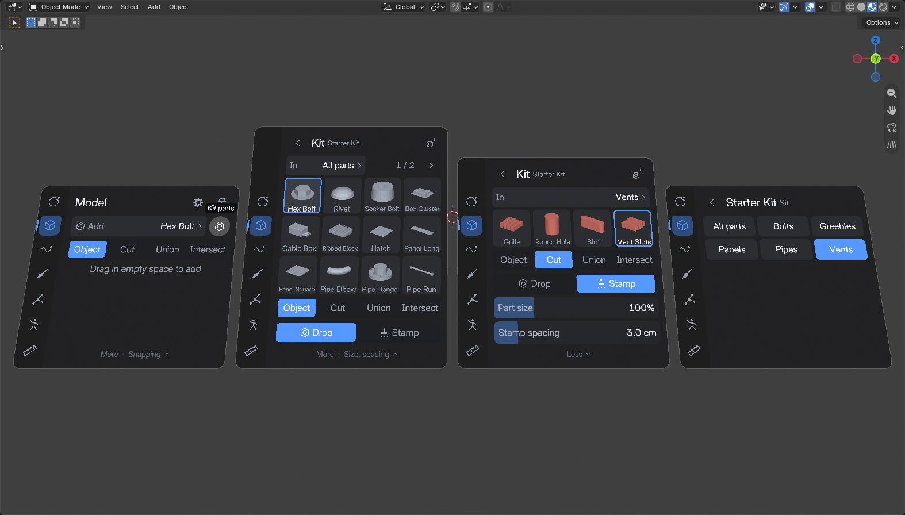
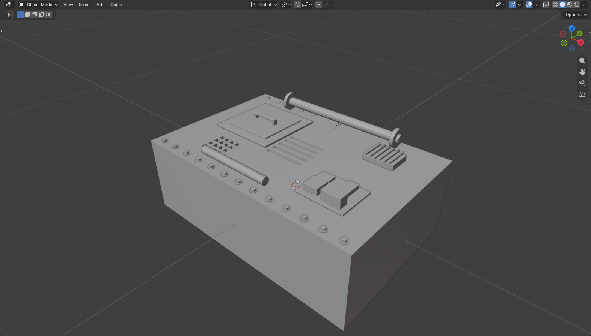
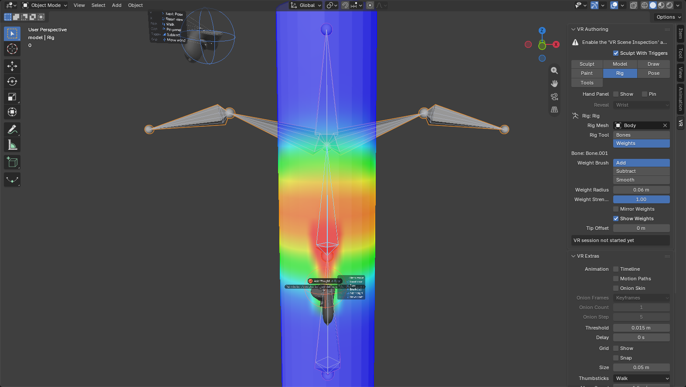
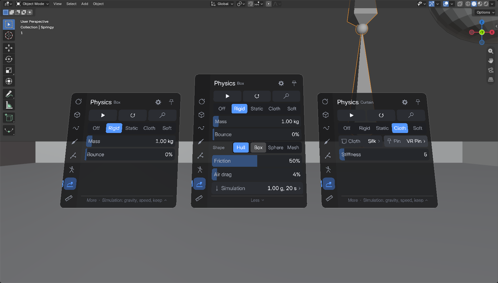
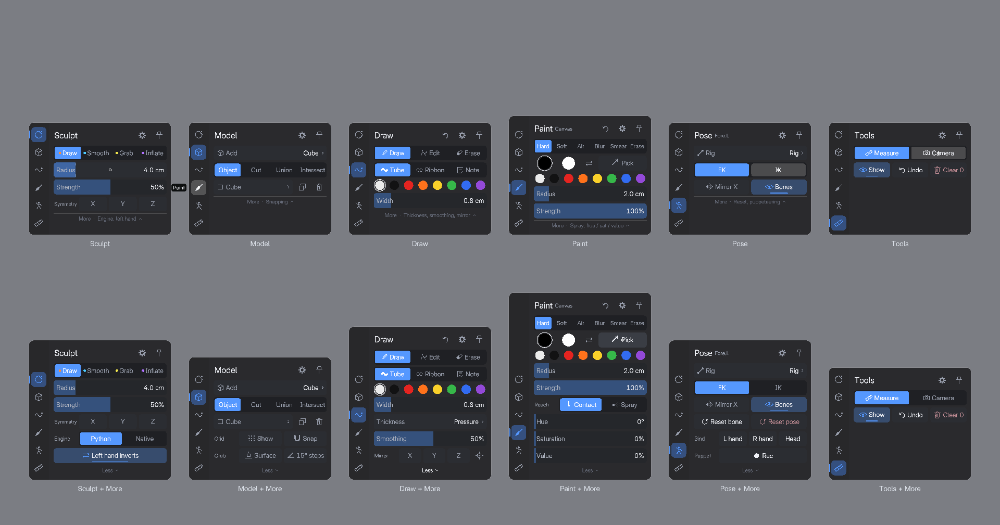

# VR Sculpt for Blender (prototype)

Sculpt, model, draw, paint, rig, pose, puppeteer, simulate and measure with VR controllers inside Blender's own VR session. Pure Python
extension, no Blender fork. Built and tested on **Blender 5.4.0 Alpha** with a
Meta Quest over OpenXR.


## Features

- **Trigger to sculpt**, pressure-sensitive. The left hand does the opposite
  (push in, deflate, ...) where that makes sense.
- **Two engines**
  - **Python brushes** (Object Mode): this add-on's own numpy brushes:
    Draw, Smooth, Grab (follows controller rotation), Inflate. X / Y / Z
    symmetry, works on moved, rotated and scaled objects.
  - **Native (experimental)** (Sculpt Mode): drives Blender's real sculpt
    brushes from the controller tip: Draw, Clay Strips, Smooth,
    Inflate/Deflate, Crease Sharp, Flatten/Contrast. With **Dyntopo**
    (Blender's dynamic topology) on, strokes add and remove detail as they go.
- **Brush cursor in the headset**: rings at each controller tip, colored per
  brush (blue when that hand inverts).
- **Quest controller models** (Meta's, converted by `tools/convert_controllers.py`)
  instead of Blender's gray spheres (SteamVR gives no controller model): pressed
  buttons move and light up, the stick tilts with yours, and a
  small legend beside each hand says what its buttons do right now (it shows
  when you look at that hand or hold it still; the left one fades out while
  the hand panel, which sits in the same place, is up). Settings > Hands
  switches back to Blender's.
- **Tip status** above the right controller: a slim line with the mode icon
  in the tool's color, the tool's name and its size (radius, stroke width, IK
  chain, lens), plus a one-line description for a few seconds after switching.
- **Haptics** on contact with the surface.
- One undo step per stroke (Python engine).
- **Model mode**: drag out any Add > Mesh primitive with the right trigger,
  and edit the primitive's settings afterwards. Primitives stay editable
  until you sculpt them. The **left trigger selects**: touch an object to
  select it (hold and move to move and rotate it), press in empty space to
  select nothing. The right trigger only makes things, so it never grabs
  what it starts in. The selection has bright blue corner brackets and its
  name above it; the left hand's ring is the same blue, and what it would
  select gets a yellow box.
- **Hard surface modeling** (Model mode). It's all modifiers, so primitives
  stay editable and nothing is final until you apply it:
  - **Live booleans**: set New to **Cut**, **Union** or **Intersect** and drag
    a primitive on or near the selected object. It becomes a cutter: a
    wireframe in the "VR Cutters" collection, parented to that object (it
    moves with it), with a Boolean modifier pointing at it. Grab a cutter, or
    change its size, and the cut follows live. The Manifold solver is used
    when both meshes are closed (about 13 ms for a 10k-vertex target, fast
    enough to follow a drag), Exact otherwise. The **Cuts** page switches a
    cutter's operation, applies or removes it, and on the object: hides all
    cutters (they keep cutting), Apply all, and the solver.
  - **Shading** (Finish page): **Flat**, **Smooth**, or **Auto** (smooth
    except edges sharper than an Angle slider, 30 degrees to start). It's a
    small "VR Shading" Geometry Nodes modifier, so it holds through primitive
    rebuilds and the flat faces that cutters bring into a cut.
  - **Hard and soft edges**: Mark **Hard** / **Soft** turns the trigger into
    a tool that marks the edges it touches (right hand marks, left hand
    clears; **Clear** clears with the right hand too). Hard edges stay sharp
    in Smooth and Auto, and soft edges stay smooth in Auto whatever their
    angle. It works on the object and its cutters, and a cutter's marks carry
    into the cut. Marks are edge attributes: Blender's own `sharp_edge` (Mark
    Sharp) for hard, `vrs_soft` for soft. They're drawn in blue and orange on
    the Finish page, and the edges in reach of each tip light up.
  - **Bevel**: an angle-limited Bevel with Harden Normals, Width and Segments
    sliders (the width in world units). If the object has no VR shading
    yet, the bevel turns on Auto shading, so flat faces stay flat and curved
    ones shade round.
  - **Array**: Linear (along X / Y / Z, with a Gap) or Radial (around a
    center you set at your left hand, about X / Y / Z), up to 24 copies.
  - **Solidify** with a Thickness slider (on the Shape page).
  - Our modifiers keep one order whatever order you add them in: Solidify,
    Booleans, Array, Mirror, Shading, Bevel. So cuts happen once,
    arrays and the mirror repeat them, and the bevel rounds the cut edges.
    Other modifiers stay where you put them. Duplicating an object copies
    its cutters and array; deleting it deletes them.
  - **Stack** page: every modifier on the object, ours and any added on
    the desktop, top to bottom. Each row has show / hide and **Apply**,
    which applies that modifier and the ones above it, so the mesh is what
    you saw (hidden ones above are skipped and stay). **Apply all** applies
    every one that shows. Open a row for its settings, read from the
    modifier's own properties (a Geometry Nodes modifier shows its group's
    inputs), Up / Down and Remove. Applying or removing a cut deletes its
    cutter, and a radial array's center goes with it. Our modifiers keep
    their order, so Up / Down only show where a move is allowed.
- **Kit parts (kitbashing)**, in Model mode: the **Kit** button beside Add
  opens your asset libraries on the hand panel, as thumbnails by catalog.
  Choose a part and the trigger places it:
  - **Drop**: pull one out of thin air and hold it to a surface. It stands on
    it, turned to its normal (twist the controller to turn it about the
    normal), whatever Snap to Surface says.
  - **Stamp**: sweep across a surface and a copy goes down every *Spacing*,
    standing on the surface and lined up with the sweep, for rows of bolts
    and greebles. Nothing is placed in the air. The tip ring shows the
    spacing.
  - With New as **Cut** / **Union** / **Intersect** and an object selected, a
    part is a live cutter on it, sunk halfway into the surface, so vents and
    holes cut as soon as you drop them. Parts tagged `cutter` (the starter
    kit's vents) switch New as to Cut when you choose them. Stamped cutters
    make one cutter together: one Boolean however many there are.
  - **Part size** scales what you place; **B** steps to the next part in the
    catalog.
  - Where parts come from: the **Starter Kit** that ships with the add-on
    (panels, vents, bolts, pipes, greebles, made by
    `tests/make_starter_kit.py`), **My Kit**, and every asset library in
    Preferences > File Paths. Mesh objects and collections marked as assets
    are parts; a collection is placed as a collection instance. Copies of a
    part share its mesh, as with Append (Reuse Data).
  - **Add to My Kit** (the + on the Kit's header) saves the selected mesh as
    it looks (modifiers applied, its scale baked in) as a new part, with a
    thumbnail rendered in VR. A cutter is saved as a cutter part. My Kit is
    a folder in the extension's user directory: add it in Preferences > File
    Paths > Asset Libraries to see your parts in the desktop Asset Browser.

  
  
- **Selecting doesn't nudge**: a grabbed object or bone (Model and Pose
  mode) only starts to follow once your hand moves past the Grab Threshold
  (1.5 cm), turns past 8 degrees, or holds the trigger for the Grab Delay
  (0.35 s, for small precise moves). The move counts from where your hand
  was just before, so nothing jumps. Both are in VR Extras > Grabbing.
- **Every Add > Mesh entry, including extensions.** The list is read from
  Blender's own Add > Mesh menu, so primitives that extensions add there show
  up too: with Extra Mesh Objects that's 42 entries (gears, pipe joints,
  gemstones, torus knots, rocks, ...). Their settings panels are built from
  the operators' own properties.
- **Draw mode**: freehand 3D strokes that become real meshes, like Gravity
  Sketch. Tube (round, never twists) and Ribbon (flat, follows your wrist's
  roll) strokes, plus Note strokes that are Blender annotations. Thickness
  from trigger pressure, from hand speed (fast = thin or fast = thick;
  averaged over ~0.3 s, eased up to 2 m/s, changing gradually along the
  stroke), Taper (thin tips ramping to full width over a share of the
  stroke's length), or fixed. Edit pulls part of a stroke into a new shape; Erase sweeps
  strokes and notes away. Mirror on X / Y / Z around the 3D cursor (editing
  one side updates the other), a stabilizer, 8 colors, and B to undo the last
  stroke.
- **Paint mode**: texture painting with Blender's own texture paint
  brushes (Hard, Soft, Airbrush, Blur, Smear, Erase), pressure-sensitive.
  **Contact** paints where the tip touches the surface, like a brush;
  **Spray** paints where the controller points, at any distance. The left
  hand paints the second color. 8 swatches, hue / saturation / value
  sliders, Swap, and **Pick color** (an eyedropper on the texture). B takes
  back the whole last stroke. **Set up for painting** gives a mesh UVs
  (Smart UV Project, if it has none) and a 1K / 2K / 4K image.
- **Rig mode**: build an armature, bind a mesh to it and paint its weights.
  Choosing Rig takes the active mesh as the one to bind (Mesh on the panel
  changes it) and its rig, or the active armature, as the one to build; with
  neither, the first bone starts a new rig whose origin is that bone's head.
  - **Bones** (the rig in Edit Mode): each trigger press places the next
    joint. A click in empty space sets a chain's root; every press after
    that ends a bone at the tip, connected to the last one (hold and move to
    place the joint precisely). A rubber band runs from the last joint to
    your hand in between. Press a joint to carry on from it: the next bone
    is that bone's child, so an inner joint branches (a root's head starts a
    new root beside it). Drag a joint to move it, with the bones connected
    there. **End chain** (or B, or the left trigger in empty space) ends the
    chain; the left trigger on a bone deletes it (its children are kept),
    as does **Delete bone** for the active one; the header's undo removes
    the last bone made. **Mirror X** (More) builds
    and edits bones off the rig's X = 0 plane in .L / .R pairs.
  - **Bind** gives the mesh an Armature modifier and automatic weights
    (Blender's bone heat; about 0.3 s for a 14k-vertex mesh). Bones that got
    no weights (outside the mesh) are named in the header.
  - **Weights** (the rig in Object Mode): paint the active bone's vertex
    group with a sphere at the tip: **Add**, **Subtract** or **Smooth**,
    pressure-sensitive, with radius and strength; the left hand does the
    opposite (Smooth smooths with both). The weights show on the mesh as a
    heat map, blue (0) to red (1), on the posed mesh. Pick the bone on the
    panel, or touch it: a press near a bone, and nearer to it than to the
    surface, picks it. B takes back the whole last stroke. More: **Mirror
    X** (the mirrored side on the .L / .R counterpart's group), **Show**,
    **Normalize** (deform weights add up to 1) and **Rebind**.


- **Tools mode**:
  - **Tape measure**: drag to measure. Ends snap to nearby mesh vertices (or
    the grid), labels use the scene's units, and measurements stay until you
    remove them (B removes the last one).
  - **Scene camera**: hold the trigger and the camera follows your controller
    (it looks where you point), with a live **camera preview** above your
    hand. Switch or add cameras and set the lens from the panel. The preview
    can also be pinned next to the hand panel in every mode. If the VR
    landmark is the scene camera (the stock add-on's default), you stay
    where you are: the first aim or switch pins the base pose there, and
    it's put back when the session ends.
- **3D grid and snapping**: a lattice of points around the controller tips,
  in scene units. Snap to Grid snaps new primitives, grabbed objects and tape
  ends. In Model mode, **Surface** makes a grabbed object sit on the mesh
  surface near it (within 3 cm), its Z turned to the surface normal: an
  object stands on it, a cutter sinks halfway in (so a cylinder drills a
  hole). Twisting still turns it about the normal; pull away and it's free.
  **15°** turns grabbed objects in 15 degree steps.
- **Symmetry**: Model mode mirrors the selected object on X / Y / Z with a
  live Mirror modifier around a "VR Mirror Center" empty (Here puts it at
  your left hand). Sculpt mode has X / Y / Z symmetry for both engines (the
  native engine uses the mesh's own symmetry flags).
- **Walk and Fly navigation** on the thumbsticks, switchable while in VR.
  Walk keeps you level, follows floors, slopes and stairs under you (but not
  tables or walls), and snap-turns. Fly goes where you look, with up/down and
  smooth turning. The speed is in hand space, so it scales with the world.
- **Tracking objects**: "VR Headset", "VR Hand Left" and "VR Hand Right"
  empties in a "VR Tracking" collection follow the headset and controllers,
  with the trigger, grip and stick values as custom properties, for parenting
  and drivers. Record keyframes them on every frame while the timeline plays.
- **Floating desktop window you can use from VR** (Windows): the whole
  Blender window on a screen in VR, menus and popups included, so editors
  without VR tools (compositor, geometry nodes, shader editor, any add-on's
  UI) work without taking the headset off. The right controller drives the
  real mouse while it points at the screen: trigger = left button (drags
  work), left trigger = middle button (pan / orbit), B = right click, right
  stick = scroll wheel. A virtual keyboard (sticky Shift / Ctrl / Alt) opens
  from the screen's title bar; drag the title bar to move the screen. It
  travels with you when you move. On other systems the screen is view only.
- **Animation**: a timeline strip next to the hand panel, in every mode:
  a frame scrubber with the selection's keys marked, play / stop, frame
  and key stepping, Key / Delete key, **Auto** (Blender's Auto Keying, which
  also keys objects and the camera when you let go of a VR grab), the
  interpolation of the keys on this frame, and Start / End to set the range
  here. Settings (the gear on the hand panel): **Timeline** shows or hides
  the strip from VR.
  - **Motion paths in 3D**: the selection's paths with a tick per frame
    (so spacing shows) and a marker on every location key. Grab a marker
    and drag to move that key; the path follows.
  - **Onion skin for meshes** (Blender only has it for Grease Pencil):
    see-through copies of the selection at the previous / next keyframes or
    every N frames, red before and green after, fainter further away. For a
    selected armature, the meshes it deforms are ghosted. Computed in a
    timer and cached (a few ms for a small rig), hidden while playing.
- **Pose mode**: pose any armature with the controllers, no constraints
  added to the rig. Choosing Pose puts the active mesh's rig (or the active
  armature) in Pose Mode; the bones are drawn on top of everything, and the
  one in reach of a tip lights up.
  - **FK**: grab a bone and it turns about its head so the grabbed point
    follows your hand; twist the controller to roll it. A free bone (the
    root, or one not connected to its parent) grabbed near its head moves
    with your hand instead.
  - **IK**: grab a bone (a hand, a foot) and it follows your hand, position
    and rotation, while 1-6 parent bones bend to reach.
  - **Mirror X** poses the .L/.R counterpart the same way. Reset bone /
    Reset pose.
  - **Limits**: bone rotation modes, rotation and location locks, and Limit
    Rotation / Limit Location constraints (Local Space) hold in FK, IK and
    moves. IK also holds the bones' IK limits and IK locks (Bone > Inverse
    Kinematics), the way Blender's IK does. Each limit is applied at every
    step of the solve, so when a joint can't bend further, the rest of the
    chain makes up for it. Try it on `tests/add_ik_limits_rig.py`, which
    adds an arm with a one-way elbow hinge, a no-twist upper arm, a limited
    wrist and a slider bone.
  - With Auto on, letting go keys the bones you moved. Key / Delete key, the
    timeline's key ticks, key jumps and interpolation work on the selected
    bones, and the selected keyed bones get motion paths.
  - Without a rig (Rig: Objects), the trigger moves the objects it touches,
    so props can be animated the same way.
- **Puppeteering**: **Bind L / Bind R / Bind head** ties the active bone (or
  object) to that controller or the headset: it keeps its offset and follows
  you live, with IK if the IK tool is on (bind a hand and the arm comes
  along). **Rec** counts down 3 seconds (with haptic beeps), then plays the
  timeline from the start and keys every bound bone, its IK chain and
  whatever the triggers are posing, on each frame, until Stop or the end of
  the range. A take only replaces what it records, so takes layer: the head
  first, then each hand.
- **Physics mode**: set up Blender's own simulations and spring bones, run
  them, and play with them using your hands.
  - **Objects**: touch a mesh to select it (hold to move it), then make it
    **Off**, **Rigid** (an active rigid body: mass, bounce; More: shape,
    friction, air drag), **Static** (a passive rigid body that things land
    on), **Cloth** (Blender's Cotton / Denim / Leather / Rubber / Silk
    presets, stiffness, pressure for balloons, mass, self collision, and
    **Pin**: none, a vertex group, or **Top edge**, which pins the highest
    row of the mesh as it stands, for curtains and flags) or **Soft** (a
    closed cloth held out by internal springs, which squashes and wobbles:
    stiffness, pressure, mass, self collision). Rigid and Static bodies get a
    Collision modifier too, so cloth and soft things land on them. It's all
    Blender's data (the Physics tab on the desktop shows the same).
  - **Simulate** (or B) plays the timeline from the start, every frame (the
    simulation only steps frame by frame); **Reset** goes back to the start.
    The **Simulation** sheet (More) has gravity, speed, the length (the
    scene's frame range, which the caches follow), and **Keep run**, which
    bakes what was just played (hands and all) so it plays back the same;
    **Clear kept** lets it run again.
  - **Spring bones**: touch a bone of the selected rig (or of the selected
    mesh's rig) and give it a **Spring**; **Whole chain** gives the bones
    below it the same one. A spring bone lags, overshoots and settles when its
    parent moves, with stiffness, damping and gravity. It's simulated live in
    VR (and while the timeline plays) on top of the bone's own pose, so keys,
    Pose mode and the desktop still pose it. **Bake** keys the frame range
    and turns those springs off; **Rest** puts them back on their pose.
  - **Hands** (a toggle, or right stick click): the controller tips push
    rigid bodies, cloth, soft things and spring bones. The trigger then
    **grabs**: a rigid body follows your hand while held and flies on with
    its speed when you let go (it starts the next run where it was); a spring
    bone's tail follows your hand and swings when let go; or, with **Push /
    Pull**, it's a force at your hand: the right trigger pulls things in, the
    left pushes them away, harder the more you squeeze.

  
- **Passthrough** toggle (Blender's own; needs a runtime that supports it).
- **Hand panel** above the left controller: an icon rail for the eight modes,
  each mode's 3-5 most used controls up front and a **More** row for the rest;
  the selected object's settings, Settings (grid, navigation, view, reveal,
  tracking) and pickers open as a second level with a Back button. It shows
  when you turn your left wrist toward your face, like checking a watch, and
  fades when you turn it back; **Pin** (the pin icon, or a left stick click)
  keeps it shown. Point at it with the right controller and pull the trigger.
  The full map of where everything is: [docs/ui_panel.md](docs/ui_panel.md).



## Controls

| Input | Sculpt mode | Model mode | Draw mode | Paint mode | Rig mode | Pose mode | Physics mode | Tools mode |
|---|---|---|---|---|---|---|---|---|
| Right trigger | Sculpt | Drag in empty space: create. Inside an object: grab. New as Cut / Union / Intersect: drag on the selected object to add a cutter | Draw / Edit / Erase | Paint / pick color | Bones: place the next joint; on a joint, carry on from it (click) or move it (drag). Weights: paint, or pick the touched bone | Grab a bone (FK / IK), or an object without a rig | Select an object (hold to move it) or a bone of the selected rig. Hands on: grab and throw a body or a spring bone, or Push / Pull: pull | Measure / aim the camera |
| Left trigger | Sculpt, inverted for Draw / Inflate (configurable) | Same as right | Same as right | Paint the second color | Bones: delete the touched bone; in empty space, end the chain. Weights: the opposite brush | Same as right | Same as right; Push / Pull: push | Same as right |
| Right trigger, pointing at the hand panel | Press buttons, drag sliders, step steppers (hold to repeat) | Same | Same | Same | Same | Same | Same | Same |
| Y (left) | Next mode (Sculpt, Model, Draw, Paint, Rig, Pose, Physics, Tools) | Same | Same | Same | Same | Same | Same | Same |
| B (right) | Next brush | Next primitive in the Add list | Undo the last stroke | Undo the last paint stroke | Bones: end the chain. Weights: undo the last weight stroke | Switch FK / IK | Simulate / stop | Remove the last measurement / next camera |
| Left stick | Walk / fly (move) | Same | Same | Same | Same | Same | Same | Same |
| Right stick | Walk: snap turn. Fly: up/down, turn | Same | Same | Same | Same | Same | Same | Same |
| Left stick click | Pin / unpin the hand panel | Same | Same | Same | Same | Same | Same | Same |
| Right stick click | Next radius (1, 2, 4, 8, 16 cm) | Same | Same | Next paint radius | Weights: next brush radius | Next IK chain length (1-4) | Hands on / off | Same |
| Right trigger on a motion path key | Drag the key | Same | Same | Same | Same | Same | Same | Same |
| Grip, A / X | Blender's stock VR navigation (unchanged) | Same | Same | Same | Same | Same | Same | Same |

Pointing at the desktop screen (in any mode, unless the tip is touching
something you're working on): right trigger = left mouse button, left
trigger = middle button, B = right click, right stick = scroll wheel.
Pointing at its title bar: drag to move it, or press Keyboard / Hide.

Trigger teleport and the stock stick navigation are replaced while "Sculpt
With Triggers" is on. The setting applies when the VR session starts.

## Install

Needs Blender 5.4+ with the bundled **VR Scene Inspection** add-on enabled
and a working OpenXR runtime.

```bash
blender --background --factory-startup --command extension build --source-dir vr_sculpt --output-dir dist
```

```bash
blender --background --command extension install-file -r user_default -e dist/vr_sculpt-0.1.0.zip
```

Then in the 3D View: **Sidebar (N) > VR > Start VR Session**. The **VR
Authoring** panel in the same tab has the engine, brush, radius, strength, tip
offset and display options; **VR Extras** has the grid, navigation, camera, desktop
window, passthrough and tracking settings (including hiding the hand panel's
"New here" camera button).

- Python engine: select a mesh in **Object Mode**.
- Native engine: select a mesh in **Sculpt Mode**. The desktop window needs a
  3D viewport, but it doesn't have to show the mesh (see below for why).

## How it works

- **Controller input.** OpenXR action sets can't be added once a session has
  started, and Blender syncs a single action set. So a
  `xr_session_start_pre` handler, inserted before the stock add-on's, edits
  the stock `blender_default` action map: it copies the teleport trigger
  bindings for every controller profile into a `vrsculpt_stroke` action
  (modal operator), and copies B/Y and stick-click bindings for brush and
  radius cycling ([actions.py](vr_sculpt/actions.py)).
- **Strokes.** [operators.py](vr_sculpt/operators.py) runs a modal operator
  per hand. XR modal events arrive every frame while the trigger is held; a
  90 Hz timer that polls the controller pose is a fallback. Errors end the
  stroke cleanly instead of leaving a timer running.
- **Python engine** ([brushes.py](vr_sculpt/brushes.py)): vertex positions in
  numpy, a hash grid for brush queries, CSR adjacency for smoothing, one
  `foreach_set` + `mesh.update()` per frame.
- **Native engine** ([native.py](vr_sculpt/native.py)): calls
  `bpy.ops.sculpt.brush_stroke` once per dab with a stroke element at the
  controller tip. **Dyntopo** is Blender's own: Sculpt > *More* > Dyntopo runs
  `sculpt.dynamic_topology_toggle`, and the detail (Brush: edge length as a
  percentage of the brush; Constant / Manual: edge length, with Fill =
  `sculpt.detail_flood_fill`) and refine (Split / Collapse / Both) rows edit
  the sculpt tool settings directly. Blender's Relative detail is in pixels of
  the desktop view, so turning dyntopo on from VR switches it to Brush. It
  refuses a mesh with Multires. The Python engine has no dyntopo: a bmesh
  round trip alone takes ~20 ms on a 50k-vertex mesh, before any splitting.
- **UVs through dyntopo** ([rest.py](vr_sculpt/rest.py)). Dyntopo resets
  every face-corner layer and scrambles shape keys (below), but carries point
  attributes onto its new vertices. So before a session each vertex gets its
  position as a hidden attribute (`.vrs_rest`), the mesh is copied with its
  vertices there (a fake-user source mesh), and shape keys become offsets
  from the basis. When the session ends, each corner is matched to the source
  in rest space and takes its value from the source triangle there
  (interpolated; the nearest corner for int data), and the shape keys are
  rebuilt with their settings, action and drivers. A corner prefers its face's
  own source polygon, and where the nearest triangle's UV jumps by more than
  the face's UV size it is across a seam and extrapolates the face's own, so
  nothing smears across seams. Sessions close from the live timer however
  Sculpt Mode is left (after Edit Mode, if that's where it went), and the
  corners also come back right away when dyntopo is turned off. Untouched
  vertices and triangles are matched exactly with numpy; only new ones need
  the BVH. About 0.4 s for 32k vertices / 65k faces when leaving Sculpt Mode.
  While a session runs, Blender draws the patches a stroke rebuilt with UV
  (0, 0) (they're without UVs inside its sculpt mesh, out of Python's reach).
  The texture icon beside Edge (*Show texture*) leaves Sculpt Mode, restores
  and comes back in, where dyntopo draws the restored mesh textured: 0.12 s at
  10k vertices, 0.43 s at 33k. **Auto** does it 2 s after the last native
  dyntopo stroke, from the live timer, when no trigger is held. Each one adds
  the two mode switches to the undo history.
- **Model mode** ([interactions.py](vr_sculpt/interactions.py),
  [primitives.py](vr_sculpt/primitives.py)): the same trigger operator picks
  a handler per press: hand panel, grab, or create. Primitive settings are a
  property group on the object whose update callbacks rebuild the mesh with
  bmesh. Booleans, finish, arrays and solidify are modifiers managed by
  [hardsurface.py](vr_sculpt/hardsurface.py); a cutter is found from the
  Boolean modifiers that point at it, so the .blend stays plain Blender data.
  [shading.py](vr_sculpt/shading.py) builds the "VR Shading" node group
  once per file. Faces are set smooth (or flat), and edges sharp where
  (angle > Angle or `sharp_edge`) and not `vrs_soft`. Blender's Smooth by
  Angle wouldn't do: it keeps flat faces flat, and its Ignore Sharpness also
  drops hand-marked edges.
  Surface snapping ([snapping.py](vr_sculpt/snapping.py)) builds BVH trees
  of the meshes near a grabbed object on first use and keeps them for the
  grab.
- **Draw mode** ([strokes.py](vr_sculpt/strokes.py), [drawing.py](vr_sculpt/drawing.py)):
  each stroke object keeps its raw samples (position, width, the
  controller's side vector) as an ID property in object space. The mesh is
  rebuilt from them with numpy (Catmull-Rom smoothing, tube rings or ribbon
  strips, mirrored copies) and written with `foreach_set`, so edits and
  mirroring stay live. Long strokes rebuild a lighter preview while the
  trigger is held (under 8 ms per frame for a 1200-sample mirrored tube) and
  the full mesh on release. Notes are 3D annotation strokes, one layer per
  color.
- **Stroke orientation**: each sample's frame normal is carried along the
  path (a rotation-minimizing frame), never taken straight from the
  controller. Projecting the controller's side axis across the stroke breaks
  down when you draw along that axis (the usual sideways stroke) and flips
  180 degrees, which made bow-ties and knots. Tubes are twist-free; ribbons
  turn toward the controller only when its side axis clearly stands across
  the stroke (judged over the last 2 cm, so jitter doesn't count), at most
  half a turn per 10 cm, and never flip.
- **Hand panel** ([vr_ui.py](vr_sculpt/vr_ui.py), [menus.py](vr_sculpt/menus.py),
  [presence.py](vr_sculpt/presence.py), [gfx.py](vr_sculpt/gfx.py)): rows of
  widgets on a card that faces the headset; the right controller's aim ray is
  intersected with the card's plane. Everything is drawn from triangles in one
  batch per panel (rounded rects, vector icons) plus `blf` text; the batch and
  the fitted text are kept in panel space and reused until a widget looks
  different or an animation runs, so a steady panel costs about 0.2 ms per eye.
  Hover, presses, the segmented controls' sliding pill and the panel's fade are
  time-based (they don't speed up with the extra draws per frame). The reveal
  rule compares the left controller's -X axis (the back of a left hand) with
  the direction to the head, and the head's view direction with the hand, with
  hysteresis. A select opens a picker page (categories first, then a paged
  grid).
- **Primitive catalog** ([catalog.py](vr_sculpt/catalog.py)): runs the Add >
  Mesh menu's draw functions (including ones extensions appended) against a
  recording layout, collecting each `layout.operator(...)` with its preset
  properties and following `layout.menu(...)` into submenus.
- **Kit parts** ([kit.py](vr_sculpt/kit.py)): reading a .blend reads the
  whole file, and asset libraries hold files of hundreds of megabytes, so
  libraries are listed by a background Blender
  ([kit_worker.py](vr_sculpt/kit_worker.py), `--background
  --factory-startup`), never in the session. It links each file's assets
  and writes their catalog, tags and preview (raw RGBA, at most 128 px) to
  a cache folder in the extension's user directory, one json per file,
  checked against the file's size and time. The session only reads that
  cache: the live timer takes each file in as the worker finishes it, so
  parts appear while it works. Listing starts when you're in Model mode in
  VR, so it's usually done before you open the Kit, and a later session
  lists from the cache with no worker at all (here: 7 ms to start, 1.1 s
  of worker for a 2.9 GB library, 3 ms from the cache, 5 ms for 44
  thumbnails). The catalogs come from the library's
  `blender_assets.cats.txt`. Thumbnails become GPU textures a few per frame
  as the panel draws them (a `tile` widget). Placing appends with `reuse_local_id` and `clear_asset_data`;
  a collection appended once is reused for every instance. Drop is a
  `MoveObject` that always surface-snaps; Stamp projects the tip onto the
  nearest surface (the same BVH trees) and places parts at exact spacing
  along the sweep, joining cutter stamps into one mesh with bmesh. Add to Kit
  writes the part with `bpy.data.libraries.write` and renders its preview
  offscreen with `gpu` (a lit three-quarter view, cutters in red).
- **Operator primitives** ([generic.py](vr_sculpt/generic.py)): the object
  stores its menu entry and the settings changed in VR; a change re-runs the
  operator and swaps the new mesh in. Drag-to-create scales length settings,
  then corrects with a uniform object scale so the shape fills the box
  exactly. Generators slower than 40 ms (e.g. Wall Factory) regenerate on
  slider release instead of every frame.
- **Animation** ([anim.py](vr_sculpt/anim.py), [paths.py](vr_sculpt/paths.py),
  [onion.py](vr_sculpt/onion.py)): 5.x actions are slotted, so F-curves come
  from the action slot's channelbag (`bpy_extras.anim_utils`). Motion paths
  are Blender's own (`object.paths_calculate`, about 30 ms for 60 frames),
  recalculated at most 10 times a second while keys change, and drawn in
  the headset from `motion_path.points`. Dragging a marker shifts that
  frame's location keys (and handles) by the hand's motion in the parent's
  space. Onion ghosts are computed in the app timer: `frame_set` to each
  ghost frame, the evaluated mesh's triangles to world space with numpy,
  then the frame is put back; they're cached until the frame, the keys or
  a watched object change (a depsgraph handler), and drawn as translucent
  batches with depth test.
- **Pose mode** ([pose.py](vr_sculpt/pose.py)): a `Follow` object holds what
  a grab started from (the bone's world matrix, the grabbed point, the
  controller pose) and each frame works out the bone's new armature-space
  matrix: a swing from the grabbed point's old direction to the tip's, plus
  the controller's twist about the bone (FK); the controller's motion applied
  rigidly (free bones, bindings); or, for IK, the rigid target for the
  bone's head with Cyclic Coordinate Descent bending the parent chain (from
  last frame's pose, so it doesn't jump between solutions). The matrices go
  back through `Bone.convert_local_to_pose(invert=True)` with each bone's
  new parent matrix, so a whole chain is written in one pass without
  waiting for Blender to re-evaluate the pose, and only the rotation (plus
  location for free bones) is set, in the bone's own rotation mode and locks.
  Mirror X writes the counterpart's local rotation as `(w, x, -y, -z)` and
  location as `(-x, y, z)`, like Blender's pose flip. In 5.x bone selection
  is `PoseBone.select`. Onion ghosts change frames, which re-applies keys,
  so the pose (and objects' transforms) are saved first and put back.
- **Puppeteering** ([puppet.py](vr_sculpt/puppet.py)): a binding is a
  `Follow` that never lets go, driven by a grip pose or the headset from the
  app timer. A take is keyed from a `frame_change_post` handler (playback
  has just applied the action for the new frame; the bindings are put back
  on top, then keyed) and from the timer, once per frame. Playback wrapping
  around ends the take; the handler only marks it, and the timer stops
  playback, since changing frames or playback from inside a frame change
  handler isn't safe.
- **Rig mode** ([rig.py](vr_sculpt/rig.py)): the Bones tool keeps the rig in
  Edit Mode (switching costs well under a millisecond) and writes edit bones
  directly: a joint is a bone's tail, or the head of a bone that isn't
  connected to its parent. What the chain carries on from (the anchor) is
  kept as names and a point in the rig's space, never as an `EditBone`,
  which a mode switch or an undo frees. Mirror X names pairs `Bone.NNN.L` /
  `.R` with both names free, so `bpy.utils.flip_name` finds a bone's
  counterpart. Bind is `object.parent_set(type='ARMATURE_AUTO')` with the
  mesh and rig in the override (any Armature modifier it had for the rig is
  removed first, as parent_set adds its own). Weights are painted by our own
  numpy brush, not `paint.weight_paint` (which, like texture paint, would
  need the desktop view aimed at every dab, and make every dab an undo
  step). Vertex groups aren't mesh attributes in 5.4, so a group is read
  once per mesh and bone into a numpy array (about 30 ms for 30k vertices)
  that the brush keeps current, and only the vertices whose weight changed
  are written, one `VertexGroup.add` each (under a microsecond apiece; a
  weight brought to 0 leaves the group). Positions come from the evaluated
  mesh at the press, so you paint the posed mesh, with brushes.py's hash grid
  and edge adjacency (Smooth). The heat map is drawn by us (Blender's weight
  overlay isn't drawn in VR): its positions and triangles are read in the
  app timer when the pose or the mesh changes, and the colored batch is
  rebuilt (at most 30 times a second) when the weights change. It lies on
  the mesh, so its small shader pulls each vertex toward the eye by 0.1% of
  its distance (same pixel, a little nearer, whatever the clip range);
  without that it z-fought with the mesh's own faces. B's undo
  keeps each stroke's previous weights per vertex.
- **Physics mode** ([physics.py](vr_sculpt/physics.py)): objects are made rigid
  with `rigidbody.object_add` / `object_remove` (an override, no area) and
  cloth (Soft too) and colliders with their modifiers, so it's Blender's
  own simulation. The simulation steps as the timeline plays, so Simulate
  plays every frame (Sync: Play Every Frame). A grabbed rigid body is made
  kinematic (Animated) and its world matrix set from the hand; Bullet keeps
  the velocity of a kinematic body when it turns dynamic again, which is the
  throw, and its own transform is put back so the next run starts the same.
  The hand colliders are passive animated rigid bodies with a Collision
  modifier ("VR Hand Collider L / R" in a "VR Physics" collection), moved to
  the tips by the app timer; their spheres are real-size meshes (a rigid
  body's shape is made once, so it can't come from the object's scale), and
  they stay shown as unselectable wire spheres: a hidden object isn't
  evaluated, so its shape comes out empty when the run is rebuilt. Push /
  Pull sets the strength of a hidden force field at each hand. Spring bones
  are our own: each one's tail is a point mass on a damped spring (0.5-8 Hz
  by stiffness, critical damping at 1) toward where its pose puts it, stepped
  at 240 Hz in real time by the app timer, kept at the bone's length, pushed
  out of the hand spheres, and turned into the bone's basis with
  `Bone.convert_local_to_pose` (parents first, as in Pose mode). What the
  bone was posed at (its base) is told apart from what we wrote last, so
  keys, Pose mode and the desktop pose it underneath; a settled spring isn't
  written, so it costs the rig no evaluation. Springs are found through the
  bones' stored settings (`bl_system_properties_get`): reading
  `PoseBone.vr_spring` would give every bone it's asked of saved settings.
  Bake reads the pose on every frame first, then simulates, then keys, so
  its own keys don't feed back into the pose it reads.
- **Paint mode** ([paint.py](vr_sculpt/paint.py)): `paint.image_paint`
  projects each dab along the 3D view, so for every dab the largest desktop
  3D view is pointed at the dab (from along the surface normal for Contact,
  from the controller for Spray), a one-element stroke is painted at the
  region center, and the view is put back right away (about 1.5-2 ms per
  dab). The brush radius is converted from hand space to pixels with that
  view's projection. The previous dab is passed as a lead-in so Smear knows
  the direction. Each call is its own undo step in Blender, so the add-on
  snapshots the image when a stroke starts; B restores it.
- **Floating desktop window** ([desktop.py](vr_sculpt/desktop.py),
  [winput.py](vr_sculpt/winput.py)): on Windows, a worker thread copies the
  window with GDI (`BitBlt` of the window DC, about 5 ms for 1920x1017,
  menus and tooltips included) at up to 30 fps, splits it into 64-row
  strips and only converts the strips that changed; the VR draw callback
  turns those into textures. Blender ignores posted window messages (it
  reads the real cursor), so input uses `SendInput` and really moves the
  mouse; a button is only pressed when `WindowFromPoint` says Blender's
  window is the one under that point, so nothing behind or over it gets
  clicked. Keys go to the foreground window, so the keyboard first makes
  Blender the active window. Elsewhere (view only), Python
  can't read the window's final image, but every region draws into its own
  buffer and a `POST_PIXEL` draw callback runs right after, on every editor
  type. There the region's pixels are read (`read_color`, about 0.5-2 ms per
  UI region, at most 4 times a second per region) into a texture, and the
  headset draws all of them at their window positions. Regions only redraw
  when something changes, so the captures stay current between redraws. 3D
  views are the exception: their callback only sees the overlay layer, so
  they are re-rendered offscreen from the same view at half resolution.
- **Camera preview** ([camera.py](vr_sculpt/camera.py)):
  `GPUOffScreen.draw_view3d` from the scene camera, which needs a 3D view's
  draw callback: it renders while the largest desktop 3D view redraws (a
  timer asks for 20 redraws a second while a preview is shown), and only the
  headset displays it.
- **Navigation** ([navigation.py](vr_sculpt/navigation.py)): the stock fly
  actions keep their bindings but run `vrsculpt.navigate`, which moves
  `XrSessionState.navigation_location` / `navigation_rotation` itself, so
  Walk / Fly is read live instead of being baked into the action map. Walk
  casts a ray down from the headset and follows changes in the surface
  height (the VR tracking origin isn't the real floor, so it keeps your
  height rather than putting you on the surface).
- **Tracking objects** ([tracking.py](vr_sculpt/tracking.py)): an app timer
  ([live.py](vr_sculpt/live.py)) sets the empties' matrices from the session
  state at 90 Hz and reads the input values with `action_state_get`; custom
  property changes are followed by `update_tag()` so drivers re-run.
- **Undo.** Every trigger action that changed something (a stroke, a grab,
  a panel press, a measurement, a pose) is one step in Blender's own undo
  history: the trigger operator is an undo operator. B's quick undos in Draw
  mode (a regular undo step that deletes the last stroke) and Paint mode (the
  add-on's own per-stroke image history, which a Blender undo or redo
  resets) work on top of it. A puppet take is one step, as are the panel
  presses around it. Undo, redo and loading a file replace Blender's data
  with new copies, so anything a held trigger action kept from before (the
  scene's settings, objects, meshes, F-curves) would point at freed memory:
  `undo_pre` / `undo_post` / `redo_*` / `load_post` handlers count those
  swaps, and a trigger operator that sees the count change lets go at once
  without touching what it kept (a held desktop mouse button is still
  released). The handlers also clear the caches that hold Blender data.
- **Drawing in the headset** ([draw.py](vr_sculpt/draw.py),
  [hud.py](vr_sculpt/hud.py)): `SpaceView3D` draw handlers on region type
  `'XR'` (headset) and `'WINDOW'` (desktop). The session's
  `show_custom_overlays` is turned on at session start. Text is drawn in 3D
  with `blf` under a `gpu.matrix` transform; brush icons come from the brush
  asset previews.

### What we learned about physics from Python (5.4.0 Alpha)

Found with [tests/probe_physics.py](tests/probe_physics.py):

- `rigidbody.object_add` works from a timer with an override of the object
  and scene (it makes the rigid body world if there's none). Removing an
  object from the world's collection doesn't remove its rigid body; the
  operator does.
- The original object's `matrix_world` follows the simulation (its own
  location doesn't), so touching and grabbing see bodies where they are.
- A body made kinematic, moved frame by frame and made dynamic again keeps
  the velocity it was moved at.
- A kinematic body moved between frames pushes the others, and a played run
  with different input is simulated again rather than read back from the
  cache.
- A force field made with `object.forcefield_toggle` acts on rigid bodies but
  not on cloth until its object is linked into the scene after the field is
  made (the link rebuilds the relations). A hidden field still acts.
- Cloth and soft body output is in object space; a soft body needs the start
  frame evaluated before it steps.
- The Soft Body modifier is too slow for this, and leaks: a 642 vertex ball
  resting on a 20 cm thick table took 260 ms a frame (140 with everything
  else in the test scene running, which took 5 ms) and in most runs sank
  through it; through a 4 cm one it always did. The same ball as a cloth
  with internal springs takes 2 ms a frame, stays on the table, and dropped
  25 cm squashes to 70% of its height and springs back, so Soft is that.
  The internal springs set how soft it is; `pressure_factor` made no
  measurable difference next to them.
- Things resting on a Mesh collision shape jitter and slide; the default
  convex hull is steady.
- `ptcache.bake_from_cache` keeps a played run (an override with the
  `point_cache`); `rigidbody.bake_to_keyframes` needs a window.
- A new cloth has none of the presets' values (shear stiffness 5, Cotton has 15).

### What we learned about asset previews (5.4.0 Alpha)

Found with [tests/probe_asset_previews.py](tests/probe_asset_previews.py)
(the kit now reads previews from the linked IDs in its worker, but this is
the way to get one without linking anything):

- `bpy.utils.previews.new().load(name, "lib.blend/Object/Name", 'BLEND')`
  returns that ID's own preview, read from the file without appending or
  linking anything (`/` or `\` both work; `Collection/Name` too). Loading
  the bare .blend path gives the file's thumbnail instead (empty here).
- `bpy.data.libraries.load(path, assets_only=True)` lists names only.
  Linking gives `asset_data` (catalog id, tags) and the preview, and
  `bpy.data.temp_data()` lets that happen in a separate Main, so the open
  file never sees it.
- Appending with `reuse_local_id=True` makes a new object that shares the
  mesh appended before, but a new collection every time.
- Appended IDs keep their asset data unless `clear_asset_data=True`.
- An object that only a collection instance shows is never evaluated: its
  `matrix_world` can be stale, so instance bounds use its own transforms.
- `gpu.init()` makes `gpu` work in `--background`, so tests and the starter
  kit's build can render previews.

### What we learned about `paint.image_paint` (5.4.0 Alpha)

- The dab lands where the element's `mouse` looks in the 3D view; its
  `location` isn't used for projection painting.
- The element's `size` is the brush radius in pixels; the locked scene size
  isn't used.
- `mode='INVERT'` paints with the secondary color.
- The colors come from the unified paint settings even when Unified Color is
  off.
- A material's paint-slot list is only refreshed by Texture Paint mode.

### What we learned about `sculpt.brush_stroke` (5.4.0 Alpha)

Found with the probes in [tests/](tests/):

- Each stroke element's **`location` is used as the dab position**, so dabs
  land at the controller tip, including on parts hidden from the desktop
  view. It is in **object space**, not world space.
- The element's **`mouse` must still be over the mesh** in a 3D viewport, or
  the dab is silently dropped. Like Paint, each dab points the largest desktop
  3D view at the tip from along the surface normal, puts the mouse at the
  region center and puts the view back (`native.AimedView`). Before, the mouse
  was the nearest vertex in the view as it was, and every dab was lost while
  the desktop view looked elsewhere.
- The element's **`size` is ignored**. The radius comes from the unified paint
  settings, even with unified size off. With the size locked to `'SCENE'`,
  `unprojected_size` is a **diameter in object space**.
- The poll needs Sculpt Mode, an active brush and a **brush-type tool active
  in the target viewport**.
- **Directional brushes** (Clay Strips, ...) do nothing with one-element
  strokes. Each call gets a zero-pressure element at the previous tip first.
- **XR action operators get a temporary context**: don't keep `context`
  across modal events. Use `bpy.context` each time.
- Python `Event` objects have no `timer` attribute.

### What we learned about dynamic topology (5.4.0 Alpha)

Found with [tests/probe_dyntopo.py](tests/probe_dyntopo.py) and
[tests/native_dyntopo.py](tests/native_dyntopo.py):

- `sculpt.dynamic_topology_toggle` runs without its warning popup when called
  from Python, also in the background. `sculpt.detail_flood_fill` **crashes
  Blender with no window**, so Fill only runs with the desktop view override.
- `Object.use_dynamic_topology_sculpting` is only true in Sculpt Mode, but the
  mesh remembers it: entering Sculpt Mode again turns dyntopo back on.
- While dyntopo sculpts, **`obj.data` isn't written** (nor the evaluated mesh
  or the scene statistics) until Sculpt Mode ends. A Sculpt / Object / Sculpt
  round trip writes it back, but costs ~45 ms at 41k vertices. So a native
  stroke's snapshot of the mesh can be far behind the surface. When the tip has
  no snapshot vertex in reach, the stroke dabs anyway with the mouse on the
  nearest one, and Blender sculpts whatever is around `location`. Haptics still
  follow the snapshot.
- What dyntopo does to mesh data (the result is all triangles):

  | Data | Result |
  |---|---|
  | Point domain: colors, vertex group weights, mask, other attributes | interpolated onto new vertices |
  | Edge crease, bevel weight, sharp, seam | kept, and both halves of a split edge keep it |
  | Face sets, material index | kept |
  | **Face corner: UV maps, corner colors, other corner attributes** | **reset** (UVs to 0, colors to white); rest.py restores them |
  | **Shape keys** | resized but scrambled (most vertices lose their offset); rest.py keeps them for sessions started from VR. Blender also leaks a few bytes per session with shape keys |
  | Multires | the toggle turns on anyway; VR Sculpt refuses it |

## Performance

Measured on the test machine.

| Mesh | Python engine, per frame | Native engine, per dab |
|---|---|---|
| 41k verts | ~0.2 ms math, ~5 ms with viewport redraw | ~0.5 ms |
| 164k verts | ~0.5 ms math, ~8 ms with viewport redraw | — |
| 655k verts | ~1.3 ms math (background, no redraw) | — |

For the Python engine, the limit is Blender rebuilding the whole mesh for
display after each update. The native engine only updates the touched part.

## Tests

Background (no window):

```bash
blender --background --factory-startup --python tests/test_brushes.py
```

```bash
blender --background --factory-startup --python tests/test_modal.py
```

```bash
blender --background --factory-startup --python tests/test_model.py
```

```bash
blender --background --factory-startup --python tests/test_generic.py
```

```bash
blender --background --factory-startup --python tests/test_draw.py
```

```bash
blender --background --factory-startup --python tests/test_tools.py
```

```bash
blender --background --factory-startup --python tests/test_paint.py
```

```bash
blender --background --factory-startup --python tests/test_anim.py
```

```bash
blender --background --factory-startup --python tests/test_pose.py
```

```bash
blender --background --factory-startup --python tests/test_ik_limits.py
```

```bash
blender --background --factory-startup --python tests/test_hard_surface.py
```

```bash
blender --background --factory-startup --python tests/test_rig.py
```

```bash
blender --background --factory-startup --python tests/test_kit.py
```

```bash
blender --background --factory-startup --python tests/test_physics.py
```

```bash
blender --background --factory-startup --python tests/test_rest.py
```

`test_kit.py` registers a temporary asset library and points My Kit at a
temporary folder, so neither your preferences nor your kit are touched.
Rebuild the starter kit (`vr_sculpt/assets/kit`) with:

```bash
blender --background --factory-startup --python tests/make_starter_kit.py
```

`test_generic.py` enables Extra Mesh Objects for its own run (factory
settings, so your preferences aren't touched) and checks all 42 entries.

Windowed (opens Blender briefly, writes `tests/*_result.txt`):
`native_engine.py`, `native_modal.py`, `native_transform.py`,
`native_dyntopo.py` (grows a bump past the stale mesh snapshot). The
`overlay_preview.py`, `panel_preview.py`, `hud_preview.py` and
`tools_preview.py` scripts render the overlay to PNG, and `dyntopo_preview.py`
the Sculpt page's dyntopo rows (`dyntopo_panels.png`); `probe_capture.py`
checks region capture and offscreen camera rendering. `anim_preview.py`
checks motion paths, key dragging, onion ghosts on a rig and playback.
`undo_preview.py` runs real undos while a tape measure and a pose grab are
held (that crashed Blender before the undo guard).
`hard_surface_preview.py` builds a beveled plate with a drilled hole, a
slot, a union boss and a radial ring of bolts, and renders it with the VR
overlay, the Model panel's pages and the Mark tool's edge highlights
(`probe_hard_surface*.py` measured the
boolean solvers and how the finish stack shades). `stack_preview.py` draws
the Stack page: the list, and the settings of a bevel, a Subdivision and
the shading's group inputs.
`physics_preview.py` sets up a body, a pinned curtain, a soft blob and a
spring bone, draws the Physics pages (`physics_panels*.png`) and the scene
with Hands on and a pull held (`physics_scene.png`).
`rig_preview.py` builds a spine and mirrored arms with simulated presses
(from a timer, no area), draws the Rig pages (`rig_panels*.png`), the Bones
tool's overlay with the rubber band (`rig_bones.png`) and the heat map after
binding and painting (`rig_weights.png`).
`pose_preview.py` enters Pose Mode the way VR does (no area), records a
puppet take while the timeline really plays, and draws the Pose page and
bones (`probe_pose.py` checked the pose API).
`kit_preview.py` draws the Kit sheet (`kit_panels.png`) and a box dressed
with dropped, stamped and cut starter parts (`kit_scene.png`).
`paint_preview.py`
paints real Contact and Spray strokes with simulated controllers and checks
color, size, undo and picking (`probe_texpaint*.py` found how).
Run the overlay one with `test_scene.blend` loaded; create that file with
`tests/make_test_scene.py`.

## Status and limits

- Prototype. Only tested on Blender 5.4.0 Alpha with Meta Quest controllers.
- The native engine's undo granularity in VR hasn't been checked, with or
  without dyntopo.
- UVs through dyntopo: a session dyntopo starts on its own from the desktop
  (Sculpt Mode entered there) gets its corners back only if the mesh already
  has rest positions from an earlier VR session, and its shape keys aren't
  kept (Blender has turned dyntopo on before anything can take them off).
  Custom normals aren't restored. Geometry added in Edit Mode between
  sessions sits at its rest positions, which can be degenerate (an extrude):
  start the next session from VR, which takes fresh ones.
- Creation is aligned to the world axes. Only Cube and Cylinder (our own
  versions) size non-uniformly to the drag box; other primitives keep their
  proportions. Surface snapping works when you grab, not while you drag out
  a new primitive.
- Hard surface: the Manifold solver needs closed meshes (an open cutter, like
  a plane, gets Exact, which is about 2.5x slower). Apply bakes the cut into
  the mesh, so the object stops being an editable primitive. Edge marks on a
  primitive survive resizing it, but not changing its segments or
  subdivisions (different edges). Edges a cut creates can't be marked
  themselves (they don't exist in the mesh); mark the cutter's edges, or
  let the Auto angle decide. The bevel follows its own 30 degree limit, not
  the hard / soft marks. Bevel width is in world units when you set it; it
  scales with the object after that. Slice (cut and keep the piece) isn't
  there yet. The Stack page shows a modifier's own values, in object units
  (the Finish and Shape sliders are in world units), and only number,
  toggle and choice settings: pick objects, vertex groups and curves on the
  desktop. Applying to a mesh other objects share gives the object its own
  copy first. Adding new modifier types from VR isn't there yet.
- Geometry-node asset primitives in Add > Mesh aren't listed yet.
- Kit parts: only mesh objects and collections are parts (no curves,
  geometry-node assets or materials). A collection part can't be a cutter.
  Remote (online) asset libraries are listed only as far as they're already
  downloaded. Stamping doesn't follow Snap Rotation, and stamps don't stamp
  onto each other (the surfaces are the ones there when the sweep starts).
  Assets without a stored preview show an icon. A library of thousands of
  files is listed in part (the first 2000).
- Using the desktop window from VR needs Windows; elsewhere it's view only,
  without menus and popups (they are temporary regions). It moves your real
  mouse while you point at it. The Blender window must be on screen and not
  minimized; clicks where another window covers it are refused (the title
  bar says so). The virtual keyboard sends US-layout key codes (letters,
  digits, a few symbols). The camera preview needs a visible desktop 3D view.
- Passthrough is Blender's own `show_passthrough`; whether it shows depends
  on the OpenXR runtime.
- Onion ghosts on heavy rigs cost one scene evaluation per ghost each time
  the frame or keys change (they wait while you pose live or puppeteer),
  and dragging motion path keys only moves object location keys; bone path
  markers are view only.
- Posing writes the bones' own transforms: constraints on the rig (its own
  IK, Copy Rotation, ...) still apply on top, so posing a constrained bone
  can look like it fights back. Pick the controls a rig is meant to be
  animated with. Only Limit constraints in Local Space at full influence
  are kept while solving (other spaces and other constraints still act
  afterwards). IK limits are measured as Blender's IK does it (twist about
  the bone, swing as X / Z), and IK stretch and stiffness are ignored.
  Mirror X needs .L/.R names with mirrored rest poses (as Symmetrize makes).
  Bindings last until Unbind or the end of the VR session. Takes key every
  frame (dense keys), with no smoothing yet.
- Rig mode: bones are made with roll 0 (fix rolls on the desktop if a
  rig needs them) and all deform. Bind runs Blender's bone heat while you
  wait, which can take seconds on a heavy mesh, and it fails silently on
  bones outside the mesh (they're named in the header). The heat map and the
  brush's copy of the weights are read when you press or switch bones, so
  weights changed on the desktop show after the next press. Mirror X for
  weights mirrors across the mesh's own X; for bones, across the rig's.
  Weights paints only bound meshes (Bind first).
- Physics mode: cloth and soft things don't push rigid bodies (Blender's
  simulations are one way), and hands can push but not grab them. Rigid
  body constraints, fluids, particles and force field objects aren't on
  the panel (set them on the desktop; they run and react the same). The
  simulation runs on Blender's main thread between headset frames, so a
  heavy one (dense cloth, many bodies, a desktop Soft Body) lowers the
  headset's frame rate, and as Simulate plays every frame it also plays in
  slow motion rather than skipping. Simulate sets the scene's playback to Play Every Frame. A run
  replays from the cache only until something changes; Keep run bakes it.
  The hand colliders show on the desktop as small wire spheres while Hands
  is on (they're removed when it's off, in another mode, or after VR).
  Spring bones are simulated in real time, not per frame, so a played
  animation's springs differ a little between runs; Bake (no hands) is the
  repeatable version, and a puppet take doesn't key them. A bone with a
  spring ignores its constraints while the spring moves it, and Pin's Top
  edge is the top as the mesh stands when you choose it.
- Paint mode needs a desktop 3D view (it paints through it) and briefly moves
  that view for each dab. In Blender's own undo history every dab is a step;
  B in VR undoes whole strokes. Clone, Fill and Mask brushes aren't on the
  hand panel (pick them on the desktop; they need extra setup).
- Hand tracking isn't possible from an add-on: Blender's VR layer doesn't
  enable OpenXR's hand tracking or hand interaction extensions, so drawing
  uses controllers.
- Blender plans to move VR out of the add-on list into core (issue #161834),
  which may change how action maps are set up.

## License

GPL-3.0-or-later, see [LICENSE](LICENSE).
