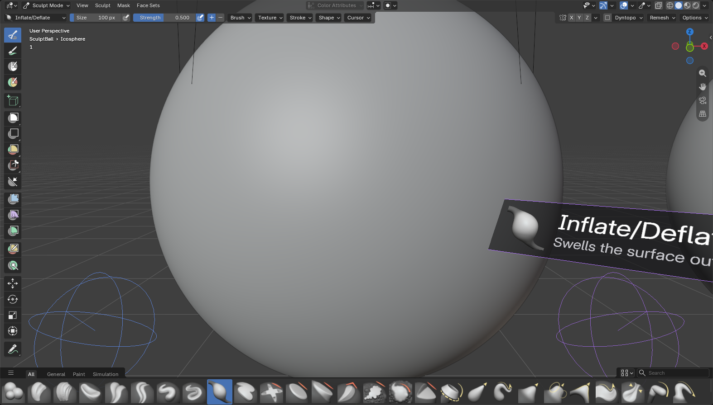
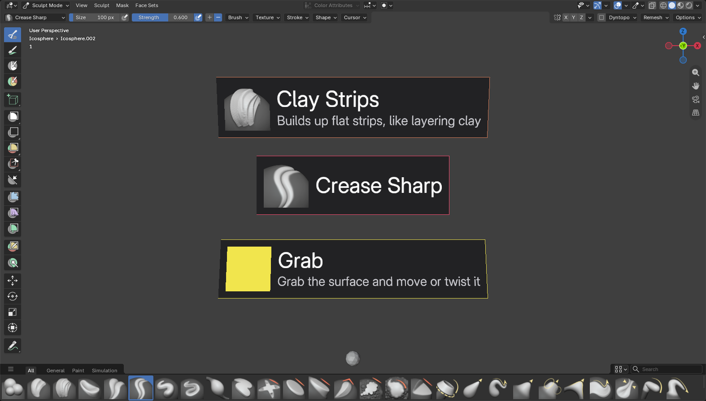

# VR Sculpt for Blender (prototype)

Sculpt, model, draw, paint, pose, puppeteer and measure with VR controllers inside Blender's own VR session. Pure Python
extension, no Blender fork. Built and tested on **Blender 5.4.0 Alpha** with a
Meta Quest over OpenXR.



## Features

- **Trigger to sculpt**, pressure-sensitive. The left hand does the opposite
  (push in, deflate, ...) where that makes sense.
- **Two engines**
  - **Python brushes** (Object Mode): this add-on's own numpy brushes:
    Draw, Smooth, Grab (follows controller rotation), Inflate. X / Y / Z
    symmetry, works on moved, rotated and scaled objects.
  - **Native (experimental)** (Sculpt Mode): drives Blender's real sculpt
    brushes from the controller tip: Draw, Clay Strips, Smooth,
    Inflate/Deflate, Crease Sharp, Flatten/Contrast.
- **Brush cursor in the headset**: rings at each controller tip, colored per
  brush (blue when that hand inverts).
- **Brush card** above the right controller: brush icon and name, plus a
  one-line description for a few seconds after switching.
- **Haptics** on contact with the surface.
- One undo step per stroke (Python engine).
- **Model mode**: drag out any Add > Mesh primitive in empty space, grab
  objects to move and rotate them, and edit the primitive's settings
  afterwards. Primitives stay editable until you sculpt them.
- **Hard surface modeling** (Model mode). It's all modifiers, so primitives
  stay editable and nothing is final until you apply it:
  - **Live booleans**: set New to **Cut**, **Union** or **Intersect** and drag
    a primitive on or near the selected object. It becomes a cutter: a
    wireframe in the "VR Cutters" collection, parented to that object (it
    moves with it), with a Boolean modifier pointing at it. Grab a cutter, or
    change its size, and the cut follows live. The Manifold solver is used
    when both meshes are closed (about 13 ms for a 10k-vertex target, fast
    enough to follow a drag), Exact otherwise. The **Cuts** page switches a
    cutter's operation, applies or removes it, and on the object: hides all
    cutters (they keep cutting), Apply all, and the solver.
  - **Shading** (Finish page): **Flat**, **Smooth**, or **Auto** (smooth
    except edges sharper than an Angle slider, 30 degrees to start). It's a
    small "VR Shading" Geometry Nodes modifier, so it holds through primitive
    rebuilds and the flat faces that cutters bring into a cut.
  - **Hard and soft edges**: Mark **Hard** / **Soft** turns the trigger into
    a tool that marks the edges it touches (right hand marks, left hand
    clears; **Clear** clears with the right hand too). Hard edges stay sharp
    in Smooth and Auto, and soft edges stay smooth in Auto whatever their
    angle. It works on the object and its cutters, and a cutter's marks carry
    into the cut. Marks are edge attributes: Blender's own `sharp_edge` (Mark
    Sharp) for hard, `vrs_soft` for soft. They're drawn in blue and orange on
    the Finish page, and the edges in reach of each tip light up.
  - **Bevel**: an angle-limited Bevel with Harden Normals, Width and Segments
    sliders (the width in world units). If the object has no VR shading
    yet, the bevel turns on Auto shading, so flat faces stay flat and curved
    ones shade round.
  - **Array**: Linear (along X / Y / Z, with a Gap) or Radial (around a
    center you set at your left hand, about X / Y / Z), up to 24 copies.
  - **Solidify** with a Thickness slider (on the Shape page).
  - Our modifiers keep one order whatever order you add them in: Solidify,
    Booleans, Array, Mirror, Shading, Bevel. So cuts happen once,
    arrays and the mirror repeat them, and the bevel rounds the cut edges.
    Other modifiers stay where you put them. Duplicating an object copies
    its cutters and array; deleting it deletes them.
- **Selecting doesn't nudge**: a grabbed object or bone (Model and Pose
  mode) only starts to follow once your hand moves past the Grab Threshold
  (1.5 cm), turns past 8 degrees, or holds the trigger for the Grab Delay
  (0.35 s, for small precise moves). The move counts from where your hand
  was just before, so nothing jumps. Both are in VR Extras > Grabbing.
- **Every Add > Mesh entry, including extensions.** The list is read from
  Blender's own Add > Mesh menu, so primitives that extensions add there show
  up too: with Extra Mesh Objects that's 42 entries (gears, pipe joints,
  gemstones, torus knots, rocks, ...). Their settings panels are built from
  the operators' own properties.
- **Draw mode**: freehand 3D strokes that become real meshes, like Gravity
  Sketch. Tube (round, never twists) and Ribbon (flat, follows your wrist's
  roll) strokes, plus Note strokes that are Blender annotations. Thickness
  from trigger pressure, from hand speed (fast = thin or fast = thick;
  averaged over ~0.3 s, eased up to 2 m/s, changing gradually along the
  stroke), Taper (thin tips ramping to full width over a share of the
  stroke's length), or fixed. Edit pulls part of a stroke into a new shape; Erase sweeps
  strokes and notes away. Mirror on X / Y / Z around the 3D cursor (editing
  one side updates the other), a stabilizer, 8 colors, and B to undo the last
  stroke.
- **Paint mode**: texture painting with Blender's own texture paint
  brushes (Hard, Soft, Airbrush, Blur, Smear, Erase), pressure-sensitive.
  **Contact** paints where the tip touches the surface, like a brush;
  **Spray** paints where the controller points, at any distance. The left
  hand paints the second color. 8 swatches, hue / saturation / value
  sliders, Swap, and **Pick color** (an eyedropper on the texture). B takes
  back the whole last stroke. **Set up for painting** gives a mesh UVs
  (Smart UV Project, if it has none) and a 1K / 2K / 4K image.
- **Tools mode**:
  - **Tape measure**: drag to measure. Ends snap to nearby mesh vertices (or
    the grid), labels use the scene's units, and measurements stay until you
    remove them (B removes the last one).
  - **Scene camera**: hold the trigger and the camera follows your controller
    (it looks where you point), with a live **camera preview** above your
    hand. Switch or add cameras and set the lens from the panel. The preview
    can also be pinned next to the hand panel in every mode.
- **3D grid and snapping**: a lattice of points around the controller tips,
  in scene units. Snap to Grid snaps new primitives, grabbed objects and tape
  ends. In Model mode, **Surface** makes a grabbed object sit on the mesh
  surface near it (within 3 cm), its Z turned to the surface normal: an
  object stands on it, a cutter sinks halfway in (so a cylinder drills a
  hole). Twisting still turns it about the normal; pull away and it's free.
  **15°** turns grabbed objects in 15 degree steps.
- **Symmetry**: Model mode mirrors the selected object on X / Y / Z with a
  live Mirror modifier around a "VR Mirror Center" empty (Here puts it at
  your left hand). Sculpt mode has X / Y / Z symmetry for both engines (the
  native engine uses the mesh's own symmetry flags).
- **Walk and Fly navigation** on the thumbsticks, switchable while in VR.
  Walk keeps you level, follows floors, slopes and stairs under you (but not
  tables or walls), and snap-turns. Fly goes where you look, with up/down and
  smooth turning. The speed is in hand space, so it scales with the world.
- **Tracking objects**: "VR Headset", "VR Hand Left" and "VR Hand Right"
  empties in a "VR Tracking" collection follow the headset and controllers,
  with the trigger, grip and stick values as custom properties, for parenting
  and drivers. Record keyframes them on every frame while the timeline plays.
- **Floating desktop window you can use from VR** (Windows): the whole
  Blender window on a screen in VR, menus and popups included, so editors
  without VR tools (compositor, geometry nodes, shader editor, any add-on's
  UI) work without taking the headset off. The right controller drives the
  real mouse while it points at the screen: trigger = left button (drags
  work), left trigger = middle button (pan / orbit), B = right click, right
  stick = scroll wheel. A virtual keyboard (sticky Shift / Ctrl / Alt) opens
  from the screen's title bar; drag the title bar to move the screen. It
  travels with you when you move. On other systems the screen is view only.
- **Animation**: a timeline strip next to the hand panel, in every mode:
  a frame scrubber with the selection's keys marked, play / stop, frame
  and key stepping, Key / Delete key, **Auto** (Blender's Auto Keying, which
  also keys objects and the camera when you let go of a VR grab), the
  interpolation of the keys on this frame, and Start / End to set the range
  here.
  - **Motion paths in 3D**: the selection's paths with a tick per frame
    (so spacing shows) and a marker on every location key. Grab a marker
    and drag to move that key; the path follows.
  - **Onion skin for meshes** (Blender only has it for Grease Pencil):
    see-through copies of the selection at the previous / next keyframes or
    every N frames, red before and green after, fainter further away. For a
    selected armature, the meshes it deforms are ghosted. Computed in a
    timer and cached (a few ms for a small rig), hidden while playing.
- **Pose mode**: pose any armature with the controllers, no constraints
  added to the rig. Choosing Pose puts the active mesh's rig (or the active
  armature) in Pose Mode; the bones are drawn on top of everything, and the
  one in reach of a tip lights up.
  - **FK**: grab a bone and it turns about its head so the grabbed point
    follows your hand; twist the controller to roll it. A free bone (the
    root, or one not connected to its parent) grabbed near its head moves
    with your hand instead.
  - **IK**: grab a bone (a hand, a foot) and it follows your hand, position
    and rotation, while 1-6 parent bones bend to reach.
  - **Mirror X** poses the .L/.R counterpart the same way. Bone rotation
    modes and rotation/location locks are respected. Reset bone / Reset pose.
  - With Auto on, letting go keys the bones you moved. Key / Delete key, the
    timeline's key ticks, key jumps and interpolation work on the selected
    bones, and the selected keyed bones get motion paths.
  - Without a rig (Rig: Objects), the trigger moves the objects it touches,
    so props can be animated the same way.
- **Puppeteering**: **Bind L / Bind R / Bind head** ties the active bone (or
  object) to that controller or the headset: it keeps its offset and follows
  you live, with IK if the IK tool is on (bind a hand and the arm comes
  along). **Rec** counts down 3 seconds (with haptic beeps), then plays the
  timeline from the start and keys every bound bone, its IK chain and
  whatever the triggers are posing, on each frame, until Stop or the end of
  the range. A take only replaces what it records, so takes layer: the head
  first, then each hand.
- **Passthrough** toggle (Blender's own; needs a runtime that supports it).
- **Hand panel** above the left controller: Sculpt / Model / Draw / Paint /
  Pose / Tools tabs, engine and brush buttons, radius and strength sliders, primitive
  settings, Duplicate and Delete. Point at it with the right controller and
  pull the trigger.



## Controls

| Input | Sculpt mode | Model mode | Draw mode | Paint mode | Pose mode | Tools mode |
|---|---|---|---|---|---|---|
| Right trigger | Sculpt | Drag in empty space: create. Inside an object: grab. New as Cut / Union / Intersect: drag on the selected object to add a cutter | Draw / Edit / Erase | Paint / pick color | Grab a bone (FK / IK), or an object without a rig | Measure / aim the camera |
| Left trigger | Sculpt, inverted for Draw / Inflate (configurable) | Same as right | Same as right | Paint the second color | Same as right | Same as right |
| Right trigger, pointing at the hand panel | Press buttons, drag sliders | Same | Same | Same | Same | Same |
| Y (left) | Next mode (Sculpt, Model, Draw, Paint, Pose, Tools) | Same | Same | Same | Same | Same |
| B (right) | Next brush | Next primitive in the Add list | Undo the last stroke | Undo the last paint stroke | Switch FK / IK | Remove the last measurement / next camera |
| Left stick | Walk / fly (move) | Same | Same | Same | Same | Same |
| Right stick | Walk: snap turn. Fly: up/down, turn | Same | Same | Same | Same | Same |
| Left stick click | Show / hide the hand panel | Same | Same | Same | Same | Same |
| Right stick click | Next radius (1, 2, 4, 8, 16 cm) | Same | Same | Next paint radius | Next IK chain length (1-4) | Same |
| Right trigger on a motion path key | Drag the key | Same | Same | Same | Same | Same |
| Grip, A / X | Blender's stock VR navigation (unchanged) | Same | Same | Same | Same | Same |

Pointing at the desktop screen (in any mode, unless the tip is touching
something you're working on): right trigger = left mouse button, left
trigger = middle button, B = right click, right stick = scroll wheel.
Pointing at its title bar: drag to move it, or press Keyboard / Hide.

Trigger teleport and the stock stick navigation are replaced while "Sculpt
With Triggers" is on. The setting applies when the VR session starts.

## Install

Needs Blender 5.4+ with the bundled **VR Scene Inspection** add-on enabled
and a working OpenXR runtime.

```bash
blender --background --factory-startup --command extension build --source-dir vr_sculpt --output-dir dist
```

```bash
blender --background --command extension install-file -r user_default -e dist/vr_sculpt-0.1.0.zip
```

Then in the 3D View: **Sidebar (N) > VR > Start VR Session**. The **VR
Authoring** panel in the same tab has the engine, brush, radius, strength, tip
offset and display options; **VR Extras** has the grid, navigation, camera, desktop
window, passthrough and tracking settings (including hiding the hand panel's
"New here" camera button).

- Python engine: select a mesh in **Object Mode**.
- Native engine: select a mesh in **Sculpt Mode** and keep it visible in the
  desktop 3D viewport (see below for why).

## How it works

- **Controller input.** OpenXR action sets can't be added once a session has
  started, and Blender syncs a single action set. So a
  `xr_session_start_pre` handler, inserted before the stock add-on's, edits
  the stock `blender_default` action map: it copies the teleport trigger
  bindings for every controller profile into a `vrsculpt_stroke` action
  (modal operator), and copies B/Y and stick-click bindings for brush and
  radius cycling ([actions.py](vr_sculpt/actions.py)).
- **Strokes.** [operators.py](vr_sculpt/operators.py) runs a modal operator
  per hand. XR modal events arrive every frame while the trigger is held; a
  90 Hz timer that polls the controller pose is a fallback. Errors end the
  stroke cleanly instead of leaving a timer running.
- **Python engine** ([brushes.py](vr_sculpt/brushes.py)): vertex positions in
  numpy, a hash grid for brush queries, CSR adjacency for smoothing, one
  `foreach_set` + `mesh.update()` per frame.
- **Native engine** ([native.py](vr_sculpt/native.py)): calls
  `bpy.ops.sculpt.brush_stroke` once per dab with a stroke element at the
  controller tip.
- **Model mode** ([interactions.py](vr_sculpt/interactions.py),
  [primitives.py](vr_sculpt/primitives.py)): the same trigger operator picks
  a handler per press: hand panel, grab, or create. Primitive settings are a
  property group on the object whose update callbacks rebuild the mesh with
  bmesh. Booleans, finish, arrays and solidify are modifiers managed by
  [hardsurface.py](vr_sculpt/hardsurface.py); a cutter is found from the
  Boolean modifiers that point at it, so the .blend stays plain Blender data.
  [shading.py](vr_sculpt/shading.py) builds the "VR Shading" node group
  once per file. Faces are set smooth (or flat), and edges sharp where
  (angle > Angle or `sharp_edge`) and not `vrs_soft`. Blender's Smooth by
  Angle wouldn't do: it keeps flat faces flat, and its Ignore Sharpness also
  drops hand-marked edges.
  Surface snapping ([snapping.py](vr_sculpt/snapping.py)) builds BVH trees
  of the meshes near a grabbed object on first use and keeps them for the
  grab.
- **Draw mode** ([strokes.py](vr_sculpt/strokes.py), [drawing.py](vr_sculpt/drawing.py)):
  each stroke object keeps its raw samples (position, width, the
  controller's side vector) as an ID property in object space. The mesh is
  rebuilt from them with numpy (Catmull-Rom smoothing, tube rings or ribbon
  strips, mirrored copies) and written with `foreach_set`, so edits and
  mirroring stay live. Long strokes rebuild a lighter preview while the
  trigger is held (under 8 ms per frame for a 1200-sample mirrored tube) and
  the full mesh on release. Notes are 3D annotation strokes, one layer per
  color.
- **Stroke orientation**: each sample's frame normal is carried along the
  path (a rotation-minimizing frame), never taken straight from the
  controller. Projecting the controller's side axis across the stroke breaks
  down when you draw along that axis (the usual sideways stroke) and flips
  180 degrees, which made bow-ties and knots. Tubes are twist-free; ribbons
  turn toward the controller only when its side axis clearly stands across
  the stroke (judged over the last 2 cm, so jitter doesn't count), at most
  half a turn per 10 cm, and never flip.
- **Hand panel** ([vr_ui.py](vr_sculpt/vr_ui.py), [menus.py](vr_sculpt/menus.py)):
  rows of buttons, sliders and selects on a card that faces the headset; the
  right controller's aim ray is intersected with the card's plane. A select
  opens a picker page (categories first, then a paged grid).
- **Primitive catalog** ([catalog.py](vr_sculpt/catalog.py)): runs the Add >
  Mesh menu's draw functions (including ones extensions appended) against a
  recording layout, collecting each `layout.operator(...)` with its preset
  properties and following `layout.menu(...)` into submenus.
- **Operator primitives** ([generic.py](vr_sculpt/generic.py)): the object
  stores its menu entry and the settings changed in VR; a change re-runs the
  operator and swaps the new mesh in. Drag-to-create scales length settings,
  then corrects with a uniform object scale so the shape fills the box
  exactly. Generators slower than 40 ms (e.g. Wall Factory) regenerate on
  slider release instead of every frame.
- **Animation** ([anim.py](vr_sculpt/anim.py), [paths.py](vr_sculpt/paths.py),
  [onion.py](vr_sculpt/onion.py)): 5.x actions are slotted, so F-curves come
  from the action slot's channelbag (`bpy_extras.anim_utils`). Motion paths
  are Blender's own (`object.paths_calculate`, about 30 ms for 60 frames),
  recalculated at most 10 times a second while keys change, and drawn in
  the headset from `motion_path.points`. Dragging a marker shifts that
  frame's location keys (and handles) by the hand's motion in the parent's
  space. Onion ghosts are computed in the app timer: `frame_set` to each
  ghost frame, the evaluated mesh's triangles to world space with numpy,
  then the frame is put back; they're cached until the frame, the keys or
  a watched object change (a depsgraph handler), and drawn as translucent
  batches with depth test.
- **Pose mode** ([pose.py](vr_sculpt/pose.py)): a `Follow` object holds what
  a grab started from (the bone's world matrix, the grabbed point, the
  controller pose) and each frame works out the bone's new armature-space
  matrix: a swing from the grabbed point's old direction to the tip's, plus
  the controller's twist about the bone (FK); the controller's motion applied
  rigidly (free bones, bindings); or, for IK, the rigid target for the
  bone's head with Cyclic Coordinate Descent bending the parent chain (from
  last frame's pose, so it doesn't jump between solutions). The matrices go
  back through `Bone.convert_local_to_pose(invert=True)` with each bone's
  new parent matrix, so a whole chain is written in one pass without
  waiting for Blender to re-evaluate the pose, and only the rotation (plus
  location for free bones) is set, in the bone's own rotation mode and locks.
  Mirror X writes the counterpart's local rotation as `(w, x, -y, -z)` and
  location as `(-x, y, z)`, like Blender's pose flip. In 5.x bone selection
  is `PoseBone.select`. Onion ghosts change frames, which re-applies keys,
  so the pose (and objects' transforms) are saved first and put back.
- **Puppeteering** ([puppet.py](vr_sculpt/puppet.py)): a binding is a
  `Follow` that never lets go, driven by a grip pose or the headset from the
  app timer. A take is keyed from a `frame_change_post` handler (playback
  has just applied the action for the new frame; the bindings are put back
  on top, then keyed) and from the timer, once per frame. Playback wrapping
  around ends the take; the handler only marks it, and the timer stops
  playback, since changing frames or playback from inside a frame change
  handler isn't safe.
- **Paint mode** ([paint.py](vr_sculpt/paint.py)): `paint.image_paint`
  projects each dab along the 3D view, so for every dab the largest desktop
  3D view is pointed at the dab (from along the surface normal for Contact,
  from the controller for Spray), a one-element stroke is painted at the
  region center, and the view is put back right away (about 1.5-2 ms per
  dab). The brush radius is converted from hand space to pixels with that
  view's projection. The previous dab is passed as a lead-in so Smear knows
  the direction. Each call is its own undo step in Blender, so the add-on
  snapshots the image when a stroke starts; B restores it.
- **Floating desktop window** ([desktop.py](vr_sculpt/desktop.py),
  [winput.py](vr_sculpt/winput.py)): on Windows, a worker thread copies the
  window with GDI (`BitBlt` of the window DC, about 5 ms for 1920x1017,
  menus and tooltips included) at up to 30 fps, splits it into 64-row
  strips and only converts the strips that changed; the VR draw callback
  turns those into textures. Blender ignores posted window messages (it
  reads the real cursor), so input uses `SendInput` and really moves the
  mouse; a button is only pressed when `WindowFromPoint` says Blender's
  window is the one under that point, so nothing behind or over it gets
  clicked. Keys go to the foreground window, so the keyboard first makes
  Blender the active window. Elsewhere (view only), Python
  can't read the window's final image, but every region draws into its own
  buffer and a `POST_PIXEL` draw callback runs right after, on every editor
  type. There the region's pixels are read (`read_color`, about 0.5-2 ms per
  UI region, at most 4 times a second per region) into a texture, and the
  headset draws all of them at their window positions. Regions only redraw
  when something changes, so the captures stay current between redraws. 3D
  views are the exception: their callback only sees the overlay layer, so
  they are re-rendered offscreen from the same view at half resolution.
- **Camera preview** ([camera.py](vr_sculpt/camera.py)):
  `GPUOffScreen.draw_view3d` from the scene camera, which needs a 3D view's
  draw callback: it renders while the largest desktop 3D view redraws (a
  timer asks for 20 redraws a second while a preview is shown), and only the
  headset displays it.
- **Navigation** ([navigation.py](vr_sculpt/navigation.py)): the stock fly
  actions keep their bindings but run `vrsculpt.navigate`, which moves
  `XrSessionState.navigation_location` / `navigation_rotation` itself, so
  Walk / Fly is read live instead of being baked into the action map. Walk
  casts a ray down from the headset and follows changes in the surface
  height (the VR tracking origin isn't the real floor, so it keeps your
  height rather than putting you on the surface).
- **Tracking objects** ([tracking.py](vr_sculpt/tracking.py)): an app timer
  ([live.py](vr_sculpt/live.py)) sets the empties' matrices from the session
  state at 90 Hz and reads the input values with `action_state_get`; custom
  property changes are followed by `update_tag()` so drivers re-run.
- **Undo.** Every trigger action that changed something (a stroke, a grab,
  a panel press, a measurement, a pose) is one step in Blender's own undo
  history: the trigger operator is an undo operator. B's quick undos in Draw
  mode (a regular undo step that deletes the last stroke) and Paint mode (the
  add-on's own per-stroke image history, which a Blender undo or redo
  resets) work on top of it. A puppet take is one step, as are the panel
  presses around it. Undo, redo and loading a file replace Blender's data
  with new copies, so anything a held trigger action kept from before (the
  scene's settings, objects, meshes, F-curves) would point at freed memory:
  `undo_pre` / `undo_post` / `redo_*` / `load_post` handlers count those
  swaps, and a trigger operator that sees the count change lets go at once
  without touching what it kept (a held desktop mouse button is still
  released). The handlers also clear the caches that hold Blender data.
- **Drawing in the headset** ([draw.py](vr_sculpt/draw.py),
  [hud.py](vr_sculpt/hud.py)): `SpaceView3D` draw handlers on region type
  `'XR'` (headset) and `'WINDOW'` (desktop). The session's
  `show_custom_overlays` is turned on at session start. Text is drawn in 3D
  with `blf` under a `gpu.matrix` transform; brush icons come from the brush
  asset previews.

### What we learned about `paint.image_paint` (5.4.0 Alpha)

- The dab lands where the element's `mouse` looks in the 3D view; its
  `location` isn't used for projection painting.
- The element's `size` is the brush radius in pixels; the locked scene size
  isn't used.
- `mode='INVERT'` paints with the secondary color.
- The colors come from the unified paint settings even when Unified Color is
  off.
- A material's paint-slot list is only refreshed by Texture Paint mode.

### What we learned about `sculpt.brush_stroke` (5.4.0 Alpha)

Found with the probes in [tests/](tests/):

- Each stroke element's **`location` is used as the dab position**, so dabs
  land at the controller tip, including on parts hidden from the desktop
  view. It is in **object space**, not world space.
- The element's **`mouse` must still be over the mesh** in a 3D viewport, or
  the dab is silently dropped. The add-on aims it at the mesh vertex nearest
  the tip.
- The element's **`size` is ignored**. The radius comes from the unified paint
  settings, even with unified size off. With the size locked to `'SCENE'`,
  `unprojected_size` is a **diameter in object space**.
- The poll needs Sculpt Mode, an active brush and a **brush-type tool active
  in the target viewport**.
- **Directional brushes** (Clay Strips, ...) do nothing with one-element
  strokes. Each call gets a zero-pressure element at the previous tip first.
- **XR action operators get a temporary context**: don't keep `context`
  across modal events. Use `bpy.context` each time.
- Python `Event` objects have no `timer` attribute.

## Performance

Measured on the test machine.

| Mesh | Python engine, per frame | Native engine, per dab |
|---|---|---|
| 41k verts | ~0.2 ms math, ~5 ms with viewport redraw | ~0.5 ms |
| 164k verts | ~0.5 ms math, ~8 ms with viewport redraw | — |
| 655k verts | ~1.3 ms math (background, no redraw) | — |

For the Python engine, the limit is Blender rebuilding the whole mesh for
display after each update. The native engine only updates the touched part.

## Tests

Background (no window):

```bash
blender --background --factory-startup --python tests/test_brushes.py
```

```bash
blender --background --factory-startup --python tests/test_modal.py
```

```bash
blender --background --factory-startup --python tests/test_model.py
```

```bash
blender --background --factory-startup --python tests/test_generic.py
```

```bash
blender --background --factory-startup --python tests/test_draw.py
```

```bash
blender --background --factory-startup --python tests/test_tools.py
```

```bash
blender --background --factory-startup --python tests/test_paint.py
```

```bash
blender --background --factory-startup --python tests/test_anim.py
```

```bash
blender --background --factory-startup --python tests/test_pose.py
```

```bash
blender --background --factory-startup --python tests/test_hard_surface.py
```

`test_generic.py` enables Extra Mesh Objects for its own run (factory
settings, so your preferences aren't touched) and checks all 42 entries.

Windowed (opens Blender briefly, writes `tests/*_result.txt`):
`native_engine.py`, `native_modal.py`, `native_transform.py`. The
`overlay_preview.py`, `panel_preview.py`, `hud_preview.py` and
`tools_preview.py` scripts render the overlay to PNG; `probe_capture.py`
checks region capture and offscreen camera rendering. `anim_preview.py`
checks motion paths, key dragging, onion ghosts on a rig and playback.
`undo_preview.py` runs real undos while a tape measure and a pose grab are
held (that crashed Blender before the undo guard).
`hard_surface_preview.py` builds a beveled plate with a drilled hole, a
slot, a union boss and a radial ring of bolts, and renders it with the VR
overlay, the Model panel's pages and the Mark tool's edge highlights
(`probe_hard_surface*.py` measured the
boolean solvers and how the finish stack shades).
`pose_preview.py` enters Pose Mode the way VR does (no area), records a
puppet take while the timeline really plays, and draws the Pose page and
bones (`probe_pose.py` checked the pose API).
`paint_preview.py`
paints real Contact and Spray strokes with simulated controllers and checks
color, size, undo and picking (`probe_texpaint*.py` found how).
Run the overlay one with `test_scene.blend` loaded; create that file with
`tests/make_test_scene.py`.

## Status and limits

- Prototype. Only tested on Blender 5.4.0 Alpha with Meta Quest controllers.
- The native engine's undo granularity in VR hasn't been checked.
- Creation is aligned to the world axes. Only Cube and Cylinder (our own
  versions) size non-uniformly to the drag box; other primitives keep their
  proportions. Surface snapping works when you grab, not while you drag out
  a new primitive.
- Hard surface: the Manifold solver needs closed meshes (an open cutter, like
  a plane, gets Exact, which is about 2.5x slower). Apply bakes the cut into
  the mesh, so the object stops being an editable primitive. Edge marks on a
  primitive survive resizing it, but not changing its segments or
  subdivisions (different edges). Edges a cut creates can't be marked
  themselves (they don't exist in the mesh); mark the cutter's edges, or
  let the Auto angle decide. The bevel follows its own 30 degree limit, not
  the hard / soft marks. Bevel width is in world units when you set it; it
  scales with the object after that. Slice (cut and keep the piece) isn't
  there yet.
- Geometry-node asset primitives in Add > Mesh aren't listed yet.
- Using the desktop window from VR needs Windows; elsewhere it's view only,
  without menus and popups (they are temporary regions). It moves your real
  mouse while you point at it. The Blender window must be on screen and not
  minimized; clicks where another window covers it are refused (the title
  bar says so). The virtual keyboard sends US-layout key codes (letters,
  digits, a few symbols). The camera preview needs a visible desktop 3D view.
- Passthrough is Blender's own `show_passthrough`; whether it shows depends
  on the OpenXR runtime.
- Onion ghosts on heavy rigs cost one scene evaluation per ghost each time
  the frame or keys change (they wait while you pose live or puppeteer),
  and dragging motion path keys only moves object location keys; bone path
  markers are view only.
- Posing writes the bones' own transforms: constraints on the rig (its own
  IK, Copy Rotation, ...) still apply on top, so posing a constrained bone
  can look like it fights back. Pick the controls a rig is meant to be
  animated with. The VR IK ignores the bones' IK limits and stretch, and
  Mirror X needs .L/.R names with mirrored rest poses (as Symmetrize makes).
  Bindings last until Unbind or the end of the VR session. Takes key every
  frame (dense keys), with no smoothing yet.
- Paint mode needs a desktop 3D view (it paints through it) and briefly moves
  that view for each dab. In Blender's own undo history every dab is a step;
  B in VR undoes whole strokes. Clone, Fill and Mask brushes aren't on the
  hand panel (pick them on the desktop; they need extra setup).
- Hand tracking isn't possible from an add-on: Blender's VR layer doesn't
  enable OpenXR's hand tracking or hand interaction extensions, so drawing
  uses controllers.
- Blender plans to move VR out of the add-on list into core (issue #161834),
  which may change how action maps are set up.

## License

GPL-3.0-or-later, see [LICENSE](LICENSE).
