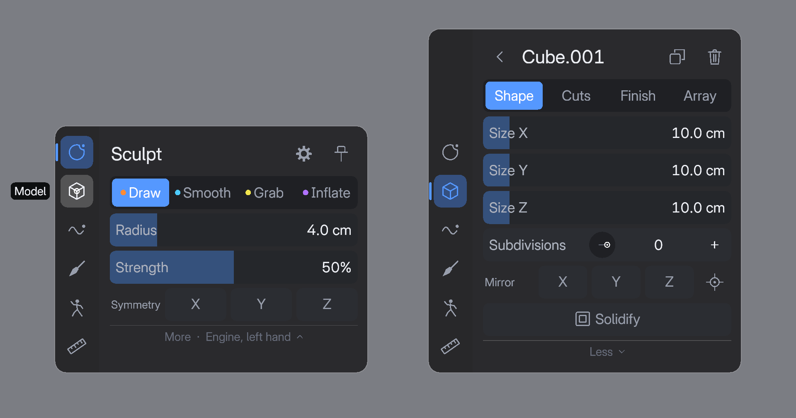
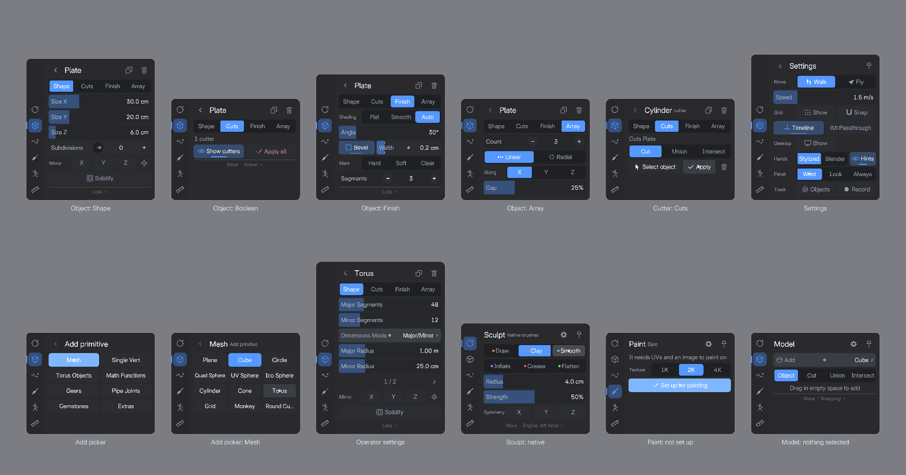
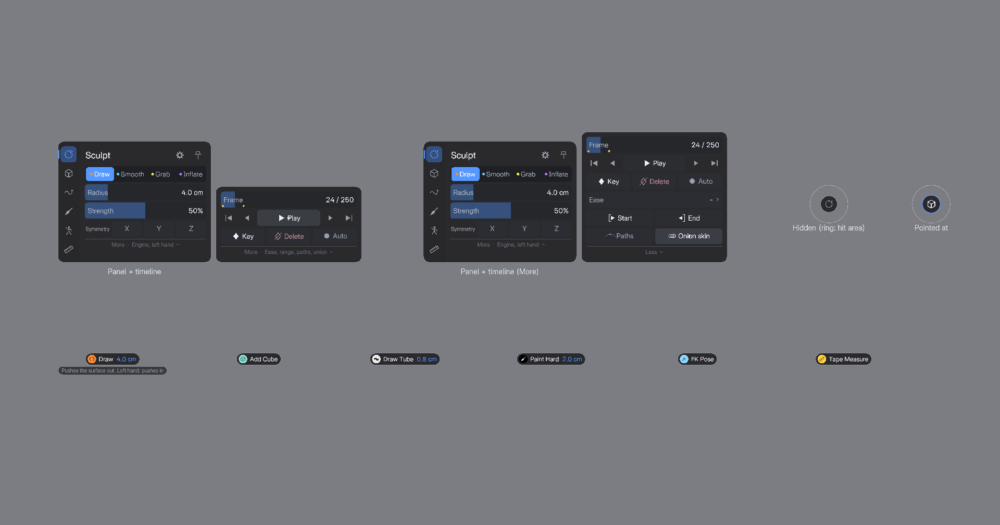
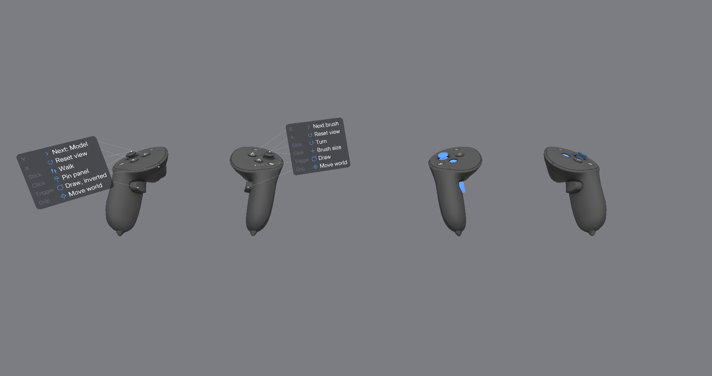
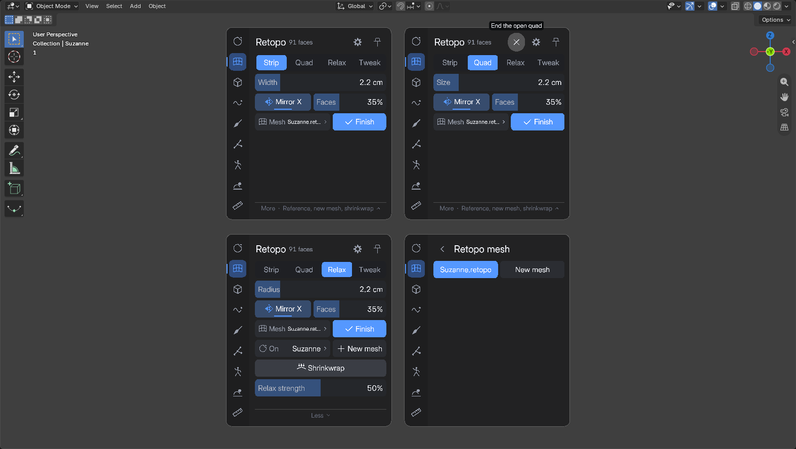
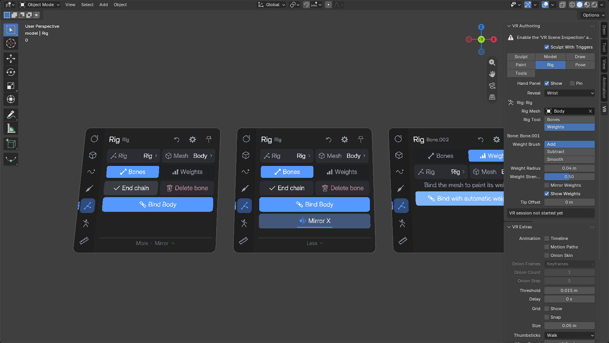
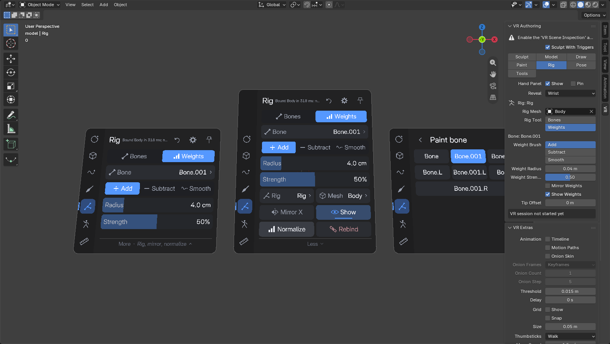
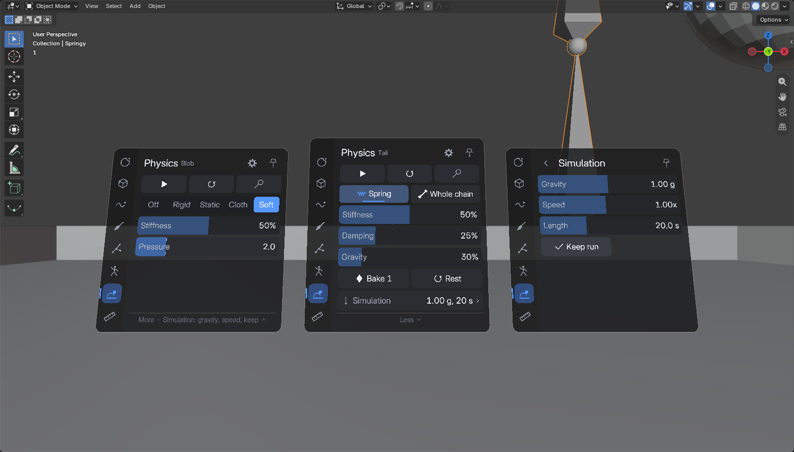

# UI rework C: the refined hand panel

One of three UI/UX reworks built side by side to compare in the headset:
A) radial / controller-centric, B) spatial / direct manipulation, and this
one, C) the same wrist-held panel as before, rebuilt.

## The hypothesis

The wrist panel is the right paradigm; the old one was just poorly executed.
A menu that lives on your off hand is always within reach, needs no new
gestures, shows state at a glance and scales to everything the add-on does
(six modes, 100+ settings). What made it feel heavy was the execution: two
rows of text tabs, every setting of a mode stacked at once (up to 14 rows),
one look for every control, no feedback, and a big card that was always in
view. If the panel is calm, compact, legible and only there when you look for
it, the paradigm should feel slick without giving up its breadth.

**This rework tests:** with the same features and the same pointing model,
does information architecture + a consistent visual language + presence
(show on demand) make the hand panel feel minimal and intuitive, while
staying the fastest way to reach *everything*?

## Design principles

1. **One paradigm, done well.** The left hand holds the panel, the right
   hand's ray points, the trigger presses (left-handed, the other way round). Nothing new to learn; no pie menus,
   no gizmos in the scene.
2. **Few things up front.** Each mode shows its 3-5 most used controls. The
   rest is one press away under **More**, which names what it holds
   ("More · Engine, other hand"). Rare or deep settings are a second level
   (object settings, Settings, pickers) with a Back button.
3. **Stable geography.** The mode rail is anchored to the bottom of the panel,
   so the six mode icons stay at the same spot above your hand whatever the
   content's height. More opens *upward*, so the More row stays under the
   pointer. Rows never reflow sideways.
4. **One widget language.** Segmented controls for exclusive choices (with a
   pill that slides to the choice), toggles with an icon and an accent bar,
   steppers (- value +) for small integers, sliders with the value inside the
   track, swatches as discs, selects with a chevron. Same heights, same
   corners, same spacing (a 3 mm grid), same type scale everywhere. Vector
   icons, drawn as shapes.
5. **Restrained palette.** Neutral dark surfaces, one accent (blue) for "on /
   chosen / here", red only on destructive actions (and only fully on hover),
   key yellow only for keyframes. Data colors (brush dots, swatches) are
   content, not chrome.
6. **Feel.** Hover eases in fast and out a little slower; a press dips the
   control and flashes it; the segmented pill and the rail's mode bar slide.
   All time-based (smooth at any frame rate). Haptics: a light tick when the
   ray moves onto a new control, a detent tick every tenth of a slider (or
   every value of a small integer slider), a tick per stepper repeat, a tap on
   the left hand when the panel appears.
7. **Out of the way.** The panel shows when you check your left wrist like a
   watch and look at it, and fades when you turn it back. A small ghost
   (the current mode's icon) marks where it is; pointing at the ghost brings
   it back. Pin keeps it. While the left trigger is held, it drops to 20%
   opacity (still pressable), so it doesn't hide what that hand works on. The big brush card is gone: a slim status line
   above the right hand carries the mode, tool and size.

## Anatomy

- **Rail** (left column): Sculpt, Retopo, Model, Draw, Paint, Rig, Pose, Physics, Tools. The current
  mode has an accent pill and a bar on the edge. Hovering an icon shows its
  name to the left of the panel. Pressing the current mode's icon returns to
  its first level from any sheet or picker.
- **Header**: the mode's name, its context in small type (engine, object,
  bone), then icon actions: the mode's undo (Draw, Paint), **Settings** (gear)
  and **Pin**.
- **Primary controls**: 3-5 rows.
- **More / Less**: the disclosure row, with a hint of what's inside. When the rail is taller than
  the page (a short page, now that the rail holds nine modes), it sits at the bottom of the card,
  so it doesn't move when it opens.
- **Second levels** replace the content (the rail stays): **object settings**
  (Model, from the selection chip), the **Kit** of parts (Model, from the icon
  beside Add; it stays open while you place), **Simulation** (Physics, from its row under More),
  **Settings** (gear, every mode), **pickers**
  (from any select, e.g. Add, Rig, Camera, Thickness, Ease).
- **Timeline strip** (when on): beside the panel, bottom-aligned, same visual
  system, with its own More.
- **Tip status**: above the right controller, always visible (unless turned
  off in VR Authoring > Show Tip Status).
- **Ghost**: a disc with the mode icon (22 mm across) just above the left
  hand, where the panel lives, while it's hidden. Pointing anywhere within
  26 mm of its center counts, so it's easy to hit without being big.

## Controllers and button hints

Blender draws the runtime's controller model when it gets one; SteamVR gives none, so it falls back
to gray spheres. Instead, the add-on draws Meta's Quest Pro controller models on the aim poses
(3 cm behind them, where Meta's models line up), textured and lit. They are converted from Meta's
controller art download by `tools/convert_controllers.py` into `vr_sculpt/assets/controllers`
(about 340 KB a hand; see the NOTICE there for the terms). Blender's are hidden while the session
runs and put back as they were when it ends (or when you switch back: **gear** > Hands > Blender,
or VR Extras > Controller Models).

- **Press feedback**: every part moves as Meta's own press animation moves it: the trigger
  swings back as you pull it and lights up in the accent by how far, the grip turns in, A / B /
  X / Y sink 1.8 mm and light up, the stick tilts up to 19 degrees with yours and lights up on a
  click or a big tilt.
- **Placement**: once per session the log gets a line `vr_sculpt controllers: left grip in aim:
  ...` with where the runtime's grip pose sits from its aim pose. If the models don't sit in your
  hands, that line is what `MODEL_OFFSET` in controllers.py gets tuned against.
- **Button hints**: beside each controller, a small legend says what each button does right now,
  with a faint leader to the button: the trigger's action in this mode and tool ("Draw",
  "Cut", "Pose IK", "Pick color", "Press" on the panel, "Click" on the desktop screen), B / Y
  ("Next brush", "Undo stroke", "IK", "Next: Model"), the sticks ("Walk" / "Fly", "Turn",
  "Scroll"), the stick clicks ("Pin panel", "Brush size", "IK chain"), A / X and the grips
  ("Reset view", Blender's, and "Move, turn world" / "Move world" by the Grip setting). The legend shows when you look at that hand, or
  hold it still for 1.2 s, and fades as soon as you press anything or move. **gear** > Hands >
  Hints turns them off.
- The model sits on the grip pose; the brush tips, rings and the panel ray still come from the aim
  pose, so nothing you aim with has moved.

## Interaction map

Notation: **Rail > Mode** is a rail icon; *More* is that mode's More row;
**chip** is Model's selected-object chip (opens the object's settings);
**gear** is Settings. Controller buttons are listed last.

### Everywhere

| Feature | How |
|---|---|
| Switch mode | **Rail** icon; or **Y** (next mode) |
| Show the panel | Turn the back of the left hand toward your face and look at it (Reveal: Wrist); point at the ghost |
| Keep it shown | **Pin** (header) or **left stick click**; again to unpin |
| Reveal mode (Wrist / Look / Always) | **gear** > Panel |
| Hide the panel entirely | VR Authoring > Hand Panel > Show (desktop) |
| Walk / Fly, move speed | **gear** > Move, Speed |
| What the grips do (Move / Turn / Free) | **gear** > Grip |
| 3D grid, snap to grid, grid size | **gear** > Grid Show / Snap, Grid size |
| Timeline strip on / off | **gear** > Timeline |
| Passthrough | **gear** > Passthrough |
| Desktop window, bring it here | **gear** > Desktop Show, Bring here |
| Tracking objects, record them | **gear** > Track Objects, Record |
| Tip status on / off | VR Authoring > Show Tip Status (desktop) |
| Quest controller models or Blender's | **gear** > Hands Quest / Blender; VR Extras > Controller Models |
| Button hints on / off | **gear** > Hands > Hints; VR Extras > Button Hints |
| Left-handed (swap the hands: panel, pointer, buttons, sticks) | **gear** > Handed Right / Left; VR Extras > Left Handed |
| What a button does now | look at that controller (or hold it still): its legend |
| Undo / redo in Blender | as before (every panel press is one undo step) |

### Sculpt

| Feature | How |
|---|---|
| Brush (Draw, Smooth, Grab, Inflate / the 6 native ones) | segmented control (colored dots match the tip rings); **B** next brush |
| Radius | slider; **right stick click** cycles 1-16 cm |
| Strength | slider |
| Symmetry X / Y / Z | toggles |
| Dyntopo on / off (native engine; UVs, corner colors and shape keys come back when the session ends) | *More* > Dyntopo |
| Dyntopo detail Brush / Constant / Manual, edge size, Fill (Constant, Manual) | *More*, beside Dyntopo; the row under it |
| Dyntopo refine Split / Collapse / Both | *More* > Refine |
| Show the texture mid-session (strokes leave their patches untextured), or automatically 2 s after a stroke | *More*: texture icon and **Auto** beside Edge (meshes with UVs or colors) |
| Engine Python / Native | *More* > Engine |
| Other hand inverts | *More* |

### Retopo

| Feature | How |
|---|---|
| Strip / Quad / Relax / Tweak | segmented control; **B** next tool |
| Lay a strip of quads (from a border edge: carry it on) | right trigger, drag on the surface (Strip) |
| Place points: four make a quad, its last edge stays open | right trigger, click (Quad); a rubber band shows the open quad |
| Start a quad from a border edge, pull one out of it | click / drag the edge (Quad) |
| Slide a vertex, merge it into another | drag it, drop it on the other (Quad) |
| End the open quad | header **X**; **B**; left trigger in empty space |
| Even out spacing, slide vertices along the surface | right trigger (Relax, Tweak) |
| Delete faces and loose vertices | left trigger, sweep (red: what goes on release) |
| Width / size / radius | slider; **right stick click** cycles 1-16 cm |
| Mirror X (across the reference's local X), face opacity | toggle, **Faces** slider |
| Retopo mesh to carry on, or a new one | **Mesh** select > picker (... **New mesh**) |
| Done: the mesh selected, in Model mode | **Finish** |
| Reference, new mesh | *More* > **On** select, **New mesh** |
| Shrinkwrap modifier onto the reference, Relax strength | *More* |

### Model

| Feature | How |
|---|---|
| Primitive to add (every Add > Mesh entry) | **Add** select > picker (categories, pages); **B** next primitive |
| Kit part to place (asset libraries) | **Kit** icon beside Add > thumbnails (pages); **In** select > library, catalog; **B** next part in the catalog |
| Drop or Stamp, part size, stamp spacing | Kit sheet: segmented control; *More* > sliders |
| Add the selection to My Kit | Kit sheet header **+** |
| New as Object / Cut / Union / Intersect | segmented control |
| Create, cut, drop or stamp kit parts | right trigger in the scene (never grabs) |
| Select, and move what's selected | left trigger: touch an object (hold to move it); in empty space, select nothing |
| Duplicate, Delete | icons beside the chip (and in the object's header) |
| Object settings | **chip** > pages Shape / Cuts / Finish / Array / Stack / UV |
| Size X/Y/Z, subdivisions; cylinder radius, height, segments; operator settings (paged) | **chip** > Shape |
| Mirror X / Y / Z, center at left hand | **chip** > Shape > *More* > Mirror |
| Solidify, thickness | **chip** > Shape > *More* |
| A cutter's operation, select its object, apply, remove | select the cutter > **chip** > Cuts |
| Show cutters, Apply all | **chip** > Cuts (on the cut object) |
| Boolean solver | **chip** > Cuts > *More* |
| Shading Flat / Smooth / Auto, angle | **chip** > Finish |
| Bevel, width | **chip** > Finish |
| Mark hard / soft / clear edges | **chip** > Finish > *More* > Mark (leaving the sheet turns it off) |
| Bevel segments | **chip** > Finish > *More* |
| Array count, linear / radial, axis, gap, center at left hand | **chip** > Array |
| Every modifier (ours and others): show / hide, apply (with those above it), Apply all | **chip** > Stack |
| A modifier's settings (paged), move up / down, remove | **chip** > Stack > the modifier's row |
| Mark / clear UV seams (trace edges; left hand clears) | **chip** > UV > Tool: Seams (leaving the page or sheet turns it off) |
| Fix stretched UVs (brush faces: they unwrap again, stitched in) | **chip** > UV > Tool: Fix; *More* > Fix radius |
| Checker / stretch view on the object | **chip** > UV > View |
| Unwrap, Smart UV, Pack | **chip** > UV |
| Unwrap method, Live unwrap, checker size | **chip** > UV > *More* |
| Seams from sharp, Even out island scale, Clear seams | **chip** > UV > *More* |
| Show grid, snap to grid | *More* > Grid |
| Snap to surface, 15 degree steps | *More* > Grab |

### Draw

| Feature | How |
|---|---|
| Draw / Edit / Erase | segmented control |
| Tube / Ribbon / Note | segmented control (with Draw) |
| Color | 8 swatches (with Draw) |
| Width | slider |
| Undo stroke | header undo icon; **B** |
| Thickness (pressure, speed, taper, fixed), taper length | *More* > Thickness picker |
| Smoothing | *More* |
| Mirror X / Y / Z, center at left hand | *More* > Mirror |

### Paint

| Feature | How |
|---|---|
| Set up a mesh (UVs + 1K / 2K / 4K image) | shown instead of the controls until the mesh is ready |
| Brush (Hard, Soft, Air, Blur, Smear, Erase) | segmented control |
| Color, 2nd color, swap | color chips and swap icon (press the 2nd chip to swap too) |
| Pick color (eyedropper) | **Pick** toggle |
| 8 swatches | swatch row |
| Radius | slider; **right stick click** |
| Strength | slider |
| Undo stroke | header undo icon; **B** |
| Contact / Spray | *More* > Reach |
| Hue / saturation / value | *More* |

### Rig

| Feature | How |
|---|---|
| Rig to build (or a new one, started by the next joint) | **Rig** select > picker (... **New rig**) |
| Mesh to bind and paint | **Mesh** select > picker (the mesh active when you chose Rig, to start) |
| Bones / Weights | segmented control (Edit Mode / Object Mode on the rig) |
| Place joints, carry on from a joint, move a joint | trigger in the scene (Bones) |
| End the chain | **End chain**; **B**; left trigger in empty space |
| Delete a bone | left trigger on it; **Delete bone** (the active one) |
| Remove the last bone made | header undo icon |
| Bind with automatic weights | **Bind** (Bones); the Weights page offers it until the mesh is bound; *More* > **Rebind** |
| Mirror X bones (.L / .R pairs) | *More* (Bones) |
| Bone to paint | **Bone** select > picker (deform bones); or touch the bone (nearer it than the surface) |
| Add / Subtract / Smooth | segmented control (left hand: the opposite) |
| Radius, strength | sliders; **right stick click** cycles the radius |
| Undo weight stroke | header undo icon; **B** |
| Rig / Mesh, Mirror X weights, show the heat map, Normalize, Rebind | *More* (Weights) |

### Pose

| Feature | How |
|---|---|
| Rig (or objects, no rig) | **Rig** select > picker |
| FK / IK | segmented control; **B** |
| IK chain | stepper (IK); **right stick click** |
| Mirror X, show bones | toggles |
| Reset bone, reset pose | *More* |
| Bind L hand / R hand / Head, Unbind, Rec | *More*; they move up front while a binding or take exists |

### Physics

| Feature | How |
|---|---|
| Pick what to set up | trigger on an object (selects it; hold to move it) or on a bone of the selected rig (or the selected mesh's rig) |
| Play / stop the simulation, back to the start | **Simulate** / **Reset**; **B** plays and stops |
| Off / Rigid / Static / Cloth / Soft (the selected mesh) | segmented control |
| Rigid: mass, bounce; shape, friction, air drag | sliders; *More* |
| Static: bounce; shape, friction | slider; *More* |
| Cloth: preset (Cotton, Denim, Leather, Rubber, Silk), pin, stiffness; pressure, mass, self collision | **Cloth** / **Pin** selects > pickers (Pin: None, **Top edge**, the vertex groups), slider; *More* |
| Soft (a cloth with internal springs): stiffness, pressure; mass, self collision | sliders; *More* |
| Spring on the active bone, the same for the bones below it | **Spring** toggle, **Whole chain** |
| Spring stiffness, damping; gravity | sliders; *More* |
| Bake the springs to keys, springs back to rest | *More* > **Bake**, **Rest** |
| Gravity, speed, length (the frame range), keep the run, clear it | *More* > **Simulation** sheet |
| Hands take part (colliders at the tips) | **Hands** toggle; **right stick click** |
| Grab and throw / Push and pull | segmented control (with Hands on); Push / Pull's force: *More* |

### Tools

| Feature | How |
|---|---|
| Measure / Camera | segmented control |
| Show measurements, undo, clear | Measure row; **B** removes the last |
| Scene camera, new camera here, pin preview, lens | Camera rows; **B** next camera |

### Timeline strip

| Feature | How |
|---|---|
| Scrub (with key ticks) | Frame slider |
| Key jumps, frame steps, play / stop | transport row |
| Key, delete key, Auto keying | key row |
| Key interpolation | *More* > Ease picker |
| Range start / end here | *More* |
| Motion paths, onion skin | *More* |

## What I expect, compared with the other two

**Better than radial (A)**
- Breadth: everything is reachable from one place with at most three presses,
  including 40+ Add > Mesh entries and operator settings with many fields; a
  pie menu tops out around eight items per ring.
- State at a glance: you see the radius, the symmetry, the brush before you
  act; pies show state only while open.
- No memorization: icons have labels or tooltips, and More says what it holds.
- Precise values: sliders, steppers and detents beat flick gestures for
  numbers.

**Worse than radial (A)**
- Slower for the top few actions: a pie is one flick, here you raise the wrist
  and point. Muscle memory has a ceiling of "turn, look, aim".
- Needs both hands: the right hand stops working to press.
- Pointing at 2 cm targets with a ray is less forgiving than a thumbstick
  direction.

**Better than spatial (B)**
- Settings that have no natural place in the world (engine, snapping, reveal,
  navigation, the timeline, paint setup) have an obvious home.
- Consistent and predictable: the same control looks and works the same in
  every mode; nothing hides behind the object you're working on.
- Works at any scale and distance from the object.

**Worse than spatial (B)**
- Indirect: you change a cube's size on a slider, not by pulling its face.
- Attention moves between the work and the hand.
- Less "freedom": it is still a menu, with a fixed place and a reading order.

**Risks of this design itself**
- The wrist rule may not match how you hold a Quest controller (see below);
  Look and Always are there to fall back on.
- More could hide something you use often; that's what the headset test should
  find (and what the "primary" lists above should be adjusted by).

## What to try in the headset

1. **Reveal.** Hold the left controller normally while sculpting with it: the
   panel should stay hidden (only the ghost). Turn the back of your left hand
   toward your face and look at it: it should fade in within a blink, with a
   tap on the left hand. Turn back: it lingers ~0.6 s, then fades. If it comes
   up when you turn the palm toward you instead, the axis is mirrored (tell
   me); meanwhile try **gear > Panel > Look**.
2. **Ghost and pin.** With the panel hidden, point at the ghost: does it come
   back? Left stick click: does it stay (pin icon filled)? Is the ghost
   noticeable but not distracting?
3. **Mode switching.** Switch modes with the rail several times without
   looking for the icons: do they stay put? Are the icons recognizable (hover
   shows the names)?
4. **Legibility.** Can you read the small labels (Symmetry, More hints) at
   your normal arm distance? Is anything too small to hit?
5. **Feel.** Hover ticks: helpful or noisy? Drag Radius slowly: do the detents
   feel like notches? Hold + on a stepper: does it repeat at a good pace?
   Does the segmented pill sliding read as "chosen"?
6. **Progressive disclosure.** In each mode, was what you needed up front? List
   anything you opened More for more than once.
7. **Model flow.** Create a cube, open it from the chip, change its size, add a
   Cut, bevel it, array it, go back. Is one level down acceptable?
8. **Tip status.** Change the radius with the right stick click: do you notice
   the size flash? Is the status line readable without being in the way?
9. **Timeline.** Scrub, play, key. Does the strip beside the panel feel like
   part of it?
10. **Rig.** With a mesh selected, choose Rig. Click at the hips, then press up the spine: does
    each press add the bone you expect, and does the rubber band follow your hand between presses?
    Click the chest joint and press out to a shoulder: a branch? Drag a joint: do the bones there
    follow? Left trigger a bone: gone, its children kept? Turn on Mirror X and build an arm. Bind,
    switch to Weights: does the heat map sit on the mesh, readable? Paint, subtract with the left
    hand, smooth; touch a bone to switch to it. Is 0.3 s of Bind acceptable on your meshes?
11. **Retopo.** Select a sculpt, choose Retopo (Y after Sculpt). Drag a strip across the forehead: do the quads come
    out square, on the surface, and keep up with your hand? Start a second drag on the strip's end edge: does it carry on?
    Quad: click four points, then two more, and again: does the strip of quads grow the way you expect, and is the
    rubber band clear? Drag a border edge out, drag a vertex onto another. Relax a messy patch, Tweak a vertex. Sweep
    the left trigger over a few faces. Turn on Mirror X and draw down the nose: centered? Are the faces readable over
    the sculpt at 35%, the edges sharp, nothing z-fighting? Finish: is the mesh there, selected, in Model mode?
11. **Physics.** Select a floor, make it Static; drag out a few cubes in Model mode, make them Rigid.
    Simulate (B): do they fall and stack? Hands on (right stick click), sweep a hand through them:
    pushed? Grab one while it plays and throw it: does it fly on? Push / Pull: does the right
    trigger draw things in, the left push them away? Make a grid Cloth, pin its Top edge: does it
    hang and react to your hands? Keep the run, Reset, Simulate: the same run? On a rig, give a tail
    or an ear a spring (Whole chain): move the rig in Pose mode, poke the bones with Hands on. Is
    the spring's default stiffness a good start?
12. **Controllers.** Do the Quest controller models sit where your real ones are (the handle in your
    hand, the face under your thumb)? Do the brush tip and the ray still come out where they did?
    Press each button: does the right part light up, and does the stick follow yours? Look at a
    hand: do the hints come up, readable, and go away once you start working? Are any of them
    wrong for the mode you're in?
13. **Overall.** Compare with A and B on: time to reach a rare setting, time for
    the top action, how calm the view is while sculpting.

## Implementation notes

- [vr_ui.py](../vr_sculpt/vr_ui.py): widgets, layout (rail + rows), hit
  testing, drawing, motion. A panel's triangles and fitted text are built in
  panel space and kept until something looks different or an animation is
  running (about 2 ms to build, 0.2 ms to draw again).
- [gfx.py](../vr_sculpt/gfx.py): the triangle batch and the 75 vector icons.
- [menus.py](../vr_sculpt/menus.py): the information architecture.
- [presence.py](../vr_sculpt/presence.py): the reveal rule. Thresholds: wrist
  55 degrees on / 70 off, gaze 32 on / 48 off, linger 0.6 s, fade 70 / 140 ms,
  20% opacity while the off-hand trigger is held.
- [hud.py](../vr_sculpt/hud.py): the tip status.
- [controllers.py](../vr_sculpt/controllers.py): the controller models (one batch per moving part,
  a small textured shader), reading the buttons
  (`action_state_get` on the add-on's and the stock actions: every Touch button already has one),
  `hints()` (pure: settings plus an `Info` of where the ray is and what's selected), the hints'
  reveal (look 28 degrees, still 1.2 s under 12 cm/s) and hiding / restoring Blender's
  controllers.
- The ghost (`vr_ui.GHOST_R`, `GHOST_HIT`): drawn radius 11 mm (12 mm when
  pointed at), hit radius 26 mm, centered 20 mm above the panel's anchor.
- [interactions.py](../vr_sculpt/interactions.py): presses, stepper repeat,
  detents, hover ticks.
- Tests: [tests/test_ui.py](../tests/test_ui.py) (disclosure, sheets, layout of
  every panel, icons, steppers, detents, the reveal rule, hidden panels not
  taking presses); the other suites press the new widgets.
- Renders: `blender --window-geometry 0 0 1920 1080 --factory-startup
  test_scene.blend --python tests/ui_preview.py` writes `tests/ui_modes.png`,
  `ui_sheets.png`, `ui_overlay.png`, `ui_detail.png` and `ui_controllers.png` (the images above).
