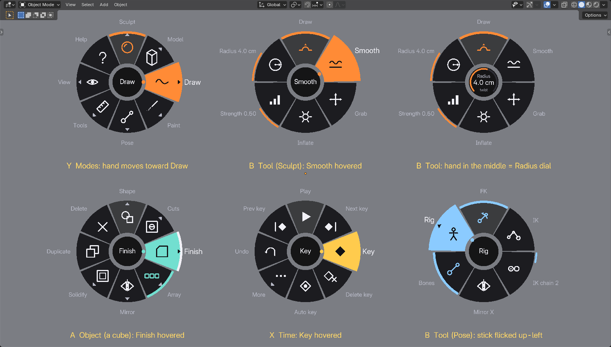
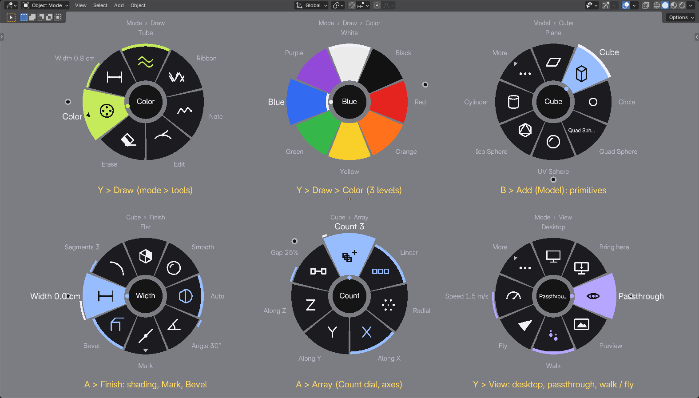
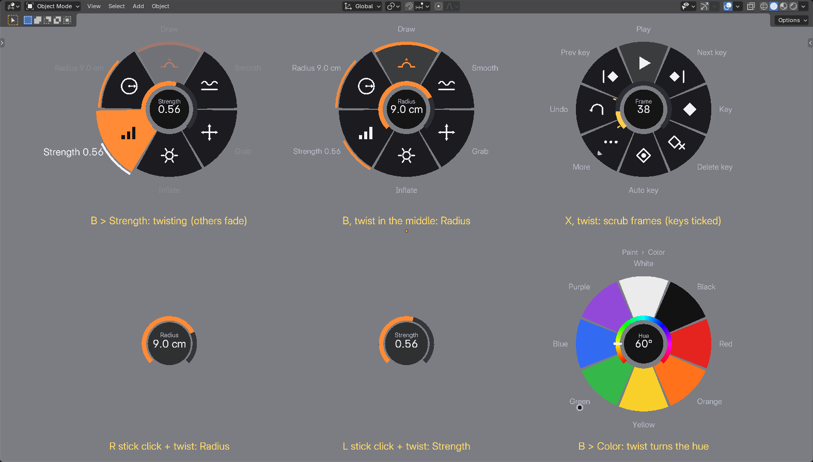
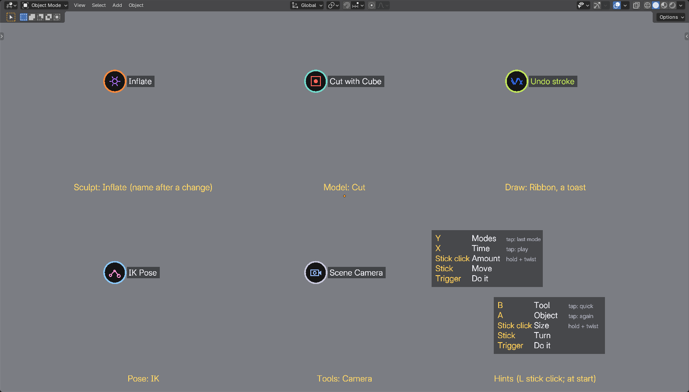

# UI rework A: radial, controller-centric

Branch `feature/ui-radial`. One of three UI/UX reworks built side by side (A radial, B spatial, C refined
panel) to compare in the headset. This one removes the hand panel entirely.

## The hypothesis

> If every setting is one press, one flick and one release away, at the hand that's already working,
> you never need to look away from the work, and after a day the gestures become muscle memory.

The panel made you stop, raise your left hand, read rows of buttons and aim a ray at them. Each of
those is a context switch. A pie at the hand costs none of them: the menu appears where your hand
already is, you pick by moving the hand a few centimeters (or flicking the stick), and letting go of
the button is the "click". Because every slice keeps its direction, the same choice becomes the same
small motion every time, like a keyboard shortcut you perform with your wrist (a marking menu).

What this rework tests:

1. Can a marking-menu UI hold *everything* this add-on does (about 150 settings and actions) without
   a panel, and stay findable?
2. Do continuous values work better as twists (a knob in your hand) than as sliders you aim at?
3. Is a tiny status badge at the tip enough to know what the trigger will do?

## Design principles

- **Eyes on the work.** Nothing persistent floats in the view: a pie exists only while you hold its
  button. The only always-on UI is a small badge above the right controller.
- **Hands are the menu.** A pie opens centered on the hand that summoned it, facing you. You pick by
  moving that hand toward a slice; the thumbstick does the same thing (flick it) when you'd rather not
  move.
- **Press, gesture, release.** Holding the button shows the pie, letting go runs what's highlighted.
  Letting go in the middle cancels. A short tap without moving is a quick action instead.
- **Directions are stable.** Slices never move: options that don't apply are greyed out in place
  instead of removed (Finish, Array, Solidify), so a gesture learned once keeps working.
- **Nesting is a continuation of the same gesture.** A slice with a chevron opens its own pie when you
  push through it or hover for half a second; the new pie is centered where your hand is, so you keep
  going in the same motion. Pull the hand back to where the previous pie was centered (a small dot marks
  it) to go back up. A trail above the ring says where you are ("Mode > Draw > Color").
- **Values are knobs, not sliders.** Point at a value (or stay in a pie's center) and twist the
  controller about its axis like a volume knob. Sizes double every quarter turn; amounts sweep their
  range in half a turn; counts click one step per 15 degrees with a haptic tick. Readouts are a gauge
  and a number at the hand; brush and paint radii also resize the real ring at the tip as you turn.
- **The trigger always means "do the thing" on the work.** The only exception: while a pie is open, the
  trigger chooses in it (so a novice can point and click instead of release).
- **Haptics carry the feedback.** A tick when a slice is hovered, a double pulse when a pie opens, a
  firm pulse on confirm, light ticks while turning a dial.
- **Transient words only.** The tool's name appears beside the badge for 1.6 s after it changes; a tap
  confirms itself with a short toast ("Undo stroke", "Again: Duplicate"); the controls cheat sheet shows
  for the first seconds of a session and on demand.

## The buttons

The upper face buttons choose *what you do*; the lower ones act on *what's there*; the stick clicks are
knobs; the triggers do it.

| Input | Hold | Tap |
|---|---|---|
| **Y** (left) | **Mode pie**: Sculpt, Model, Draw, Paint, Pose, Tools; View; Help. Each mode opens its tools. | Back to the previous mode |
| **B** (right) | **Tool pie** for this mode: brushes / tools / styles, and how big / strong. Center: the size dial | The old B: next brush (Sculpt), next primitive (Model), undo stroke (Draw, Paint), FK / IK (Pose), remove last measure / next camera (Tools) |
| **A** (right) | **Object pie**: the thing you work on (the selected object's Shape / Cuts / Finish / Array / Mirror / Solidify / Duplicate / Delete; the bone; stroke settings; the camera) | Repeat the last pie action (not dangerous ones) |
| **X** (left) | **Time pie**: play, keys, auto key, undo; center: twist to scrub frames | Play / stop |
| **Right stick click** | Knob: twist the right hand to change the mode's **size** (radius, width, IK chain, lens, ...) | Next radius step (as before) |
| **Left stick click** | Knob: twist the left hand to change the mode's **amount** (strength, smoothing; elsewhere the frame) | Show the controls cheat sheet |
| **Triggers** | Sculpt / create / grab / draw / paint / pose / measure, as before (left inverts) | |
| **Sticks** | Walk / fly, as before. While a pie or knob is held on that hand, its stick picks instead | |
| **Grips** | Blender's stock grab-the-world navigation (unchanged) | |
| **B while pointing at the desktop screen** | Right click (no pie), as before | |

Stock Blender used A / X for "reset navigation"; that is now Mode pie > View > More > Reset view.

## Interaction map

Every feature in the README's Features and Controls, and how to reach it. "B > Add > Cube" means: hold
B, move toward Add, keep going (or hover) into its pie, move toward Cube, let go.

### Everywhere

| Feature | How |
|---|---|
| Switch mode | Y > mode, let go. Y tap toggles back to the previous mode |
| A mode's tools without switching first | Y > mode > (its tool pie) > tool: switches mode and picks the tool in one gesture |
| Undo / Redo (Blender's) | X > Undo; X > More > Redo |
| Desktop window show / hide, bring in front | Y > View > Desktop; Y > View > Bring here (also shows it) |
| Use the desktop window | Unchanged: point and trigger, left trigger = middle button, B = right click, right stick = wheel, title bar = Keyboard / Hide / drag |
| Passthrough | Y > View > Passthrough |
| Camera preview pinned (above the left hand) | Y > View > Preview, or (Tools, Camera) A > Pin preview |
| Walk / Fly, speed | Y > View > Walk / Fly; Y > View > Speed (dial) |
| Tracking objects, Record | Y > View > Tracking; Y > View > More > Record |
| Reset the view to the session start | Y > View > More > Reset view |
| Grid, snap to grid, grid size | Y > View > More > Grid / Snap to grid / Grid size; also B (Model > Snap, Tools) |
| Controls cheat sheet | Left stick click (tap), Y > Help; shown automatically when the session starts |
| Brush cursor rings, haptics on contact, one undo per stroke | Unchanged |
| Tool status | The badge above the right controller: tool icon in the tool's color, ringed in the mode's color |

### Timeline and animation (X)

| Feature | How |
|---|---|
| Scrub frames | X, twist (5 degrees a frame; stick X nudges); the gauge ticks show the selection's keys. Or the left knob in Model / Pose / Tools |
| Play / stop | X tap, or X > Play |
| Previous / next key, previous / next frame | X > Prev key / Next key; X > More > Frame -1 / +1 |
| Key / delete key | X > Key / Delete key |
| Auto keying | X > Auto key |
| Interpolation of the keys on this frame | X > More > Ease > Bezier / Linear / Constant |
| Range start / end here | X > More > Start here / End here |
| Motion paths, onion skin | X > More > Paths / Onion |
| Drag a motion path key | Unchanged: trigger on its marker |

### Sculpt

| Feature | How |
|---|---|
| Brush (Python: Draw, Smooth, Grab, Inflate; Native: Draw, Clay, Smooth, Inflate, Crease, Flatten) | B > brush. B tap: next brush |
| Radius | Right knob; B and twist in the middle; B > Radius |
| Strength | Left knob; B > Strength |
| Radius steps 1-16 cm | Right stick click (tap) |
| Engine Python / Native | A > Python / Native |
| Symmetry X / Y / Z | A > Symmetry X / Y / Z |

### Model

| Feature | How |
|---|---|
| Create (drag in empty space), grab, rotate | Unchanged: trigger |
| Which primitive (every Add > Mesh entry, extensions included) | B > Add > (category >) entry; long lists page with More. B tap: next primitive |
| New as Object / Cut / Union / Intersect | B > Object / Cut / Union / Intersect |
| Mark edges Hard / Soft / Clear / Off | B > Mark > ..., or A > Finish > Mark > ... |
| Snap: grid, surface, 15 degrees, grid size | B > Snap > Grid / Snap / Surface / 15 deg / Grid size |
| Primitive settings (size X / Y / Z, subdivisions, radius, height, segments, any operator's settings incl. enums and toggles) | A > Shape > setting (dials twist; enums open a pie; toggles flip) |
| Cutter: operation, select its object, apply, remove | A > Cuts > Cut / Union / Intersect / Select object / Apply / Remove (cutter selected) |
| Object's cuts: show cutters, apply all, solver Fast / Exact | A > Cuts > ... (object selected) |
| Shading Flat / Smooth / Auto, Auto angle | A > Finish > Flat / Smooth / Auto (again = off); Angle (dial, greyed out until Auto) |
| Bevel, width, segments | A > Finish > Bevel; Width, Segments (dials) |
| Array count, Linear / Radial, axis, gap, radial center at the left hand | A > Array > Count (dial), Linear / Radial, X / Y / Z, Gap (dial) or Center here |
| Mirror X / Y / Z, center at the left hand | A > Mirror > ... |
| Solidify and thickness | A > Solidify (let go: toggle) > Thickness (dial) |
| Duplicate / Delete | A > Duplicate / Delete. A tap repeats the last (e.g. Duplicate again) |
| The right knob in Model mode | Turns the last value you turned on the object (bevel width, array count, size, ...); grid size until then |

### Draw

| Feature | How |
|---|---|
| Tube / Ribbon / Note, Edit, Erase | B > Tube / Ribbon / Note / Edit / Erase |
| Color (8) | B > Color > swatch |
| Width | Right knob; B and twist in the middle; B > Width. Right stick click steps 2-32 mm |
| Smoothing (stabilizer) | Left knob; A > Smoothing |
| Thickness by pressure / speed / taper / fixed, taper length | A > Thickness > mode; Taper (dial) |
| Mirror X / Y / Z, center here | A > Mirror X / Y / Z, Center here |
| Undo last stroke | B tap; A > Undo stroke |

### Paint

| Feature | How |
|---|---|
| Set up for painting (1K / 2K / 4K) | B (or A) on a mesh that isn't ready: Set up 1K / 2K / 4K. A > Image redoes it |
| Brush (Hard, Soft, Airbrush, Blur, Smear, Erase) | B > Brush > ... |
| Color swatches, hue | B > Color > swatch; twist in its middle turns the hue (a gray turns into a full color) |
| Hue / saturation / value | A > Hue / Saturation / Value (dials with color gauges) |
| Contact / Spray, Pick color, Swap colors | B > Contact / Spray / Pick color / Swap |
| Radius, strength | Right knob / left knob; B > Radius / Strength. Right stick click steps the radius |
| Undo last paint stroke | B tap; A > Undo stroke |
| Second color | Left trigger paints it; Swap exchanges them |

### Pose and puppeteering

| Feature | How |
|---|---|
| FK / IK | B > FK / IK; B tap switches |
| IK chain length | Right knob; B > IK chain; right stick click steps 1-4 |
| Mirror X, show bones | B > Mirror X / Bones |
| Choose the rig (or Objects, no rig) | B > Rig > ... |
| Reset bone / reset pose | A > Reset bone / Reset pose |
| Bind L / R / head, unbind | A > Bind L / Bind R / Bind head; A > Unbind |
| Record a take (countdown, keys every frame) | A > Rec; A > Stop rec. The badge turns red with the countdown / REC |
| Key, auto key, keys on this frame | X pie (works on the selected bones) |

### Tools

| Feature | How |
|---|---|
| Tape measure / scene camera | B > Measure / Camera |
| Show measurements, remove the last, clear all | A > Show / Undo last / Clear. B tap removes the last |
| Switch / add camera, lens | A > (camera name) > camera; A > New here; A > Lens (dial), or the right knob. B tap: next camera |
| Aim the camera | Unchanged: hold the trigger |

## What it should do better than a panel

- **No context switch.** Nothing to raise, read or aim at; the menu comes to the hand that's working
  and leaves when you let go. The view stays clear of UI.
- **Speed through muscle memory.** Frequent changes become one flick (B, right, release = Smooth)
  that experts do without waiting for the pie to draw (it fades in after 40 ms, and picks work before
  it's visible).
- **Values feel physical.** Twisting is precise, relative, can't "miss" a slider, and leaves the hand
  where it is: the brush ring grows at the tip while you watch the surface.
- **Both hands are equal.** Either hand opens pies; either trigger confirms. Stick picking works for
  seated use or tired arms.
- **Scales without clutter.** More settings mean deeper pies (or a More slice), not a taller panel.

## What it will probably do worse

- **Discoverability.** Nothing is visible until you ask. First-time users depend on the cheat sheet,
  the labels around the ring and the trail; "where is Solidify?" is harder than scanning a panel.
- **Comparing and reading state.** A panel shows many values at once (radius, strength, symmetry,
  colors); here you see one at a time (the badge, a hovered dial).
- **Deep, rarely used settings** (an operator primitive with 11 settings, the Add catalog with 42
  entries) take several hops and a More slice. A panel's paged list is better for browsing.
- **Fine numeric entry** (exactly 12.5 mm): twisting is relative; there is no typing. A panel slider
  shows the whole range at once.
- **Accidental dwell.** Hovering a branch for half a second opens it, which can surprise novices who
  pause to read.
- **Wrist comfort.** Large changes need several twists (let go, turn back, twist again), and twisting
  with the arm raised is tiring.
- **Button budget.** All four face buttons and both stick clicks are taken; Blender's stock A / X
  navigation reset moved into a pie.

## What to try in the headset

1. **First minute, no instructions.** Read the cheat sheet that appears at the start. Can you switch
   to Draw, pick Ribbon and a blue color without help? (Y > Draw > Ribbon, then B > Color > Blue.)
2. **Speed run.** In Sculpt, switch Draw -> Smooth -> Inflate -> Draw ten times. Do you stop looking
   at the pie after a few? Compare with the old panel.
3. **Knobs.** Sculpt while changing the radius with the right stick click + twist, and the strength
   with the left. Does the ring growing at the tip feel right? Is a quarter turn per doubling too fast
   or too slow?
4. **Deep settings.** Make a gear (B > Add > Gears > Gear), then change its teeth (A > Shape > Teeth,
   twist). Then bevel and array a cube (A > Finish > Bevel, Width; A > Array > Count, Radial). Count
   the hops; did any feel lost?
5. **Stick picking.** Do the same flicks with the stick only (hand still). Which do you prefer?
6. **Sticky pies.** Let go on a branch (e.g. A > Shape) and choose with the trigger. Does that
   novice path feel natural, or confusing?
7. **Animation.** Hold X and twist to scrub; key with X > Key; play with an X tap. Is the time pie a
   good home for the timeline, or do you miss seeing the strip?
8. **Status.** Work for a few minutes, then ask yourself: did you always know what the trigger would
   do? Was the badge enough?
9. **Fatigue.** After 20 minutes: wrists, accidental pies, accidental dwell-opens, moments of "where
   was that?". Note them; they decide whether this direction is worth keeping or mixing with another.

## Implementation notes

- [radial.py](../vr_sculpt/radial.py): the pie state machine, dials and knobs, pure math (no drawing,
  no bpy context), so [tests/test_radial.py](../tests/test_radial.py) drives every gesture.
- [menus.py](../vr_sculpt/menus.py): what each pie contains, the knobs' values per mode and the taps.
  Actions look up `bpy.context` when they run.
- [radial_draw.py](../vr_sculpt/radial_draw.py) and [icons.py](../vr_sculpt/icons.py): drawing (wedges,
  gauges, badge, hints) and about 100 vector icons, tessellated once.
- [operators.py](../vr_sculpt/operators.py): `vrsculpt.pie` and `vrsculpt.knob` (modal while the
  button is held; an undo step per choice), and the trigger routing to an open pie.
- [actions.py](../vr_sculpt/actions.py): A / X take over the stock `nav_reset` bindings, B / Y and the
  stick clicks are copied from the stock viewfinder ones, as modal actions so a hold can be told from
  a tap. [navigation.py](../vr_sculpt/navigation.py) reads a stick for the pie and leaves it alone while
  a pie or knob holds it.
- Preview: `blender --factory-startup test_scene.blend --python tests/radial_preview.py` renders the
  sheets in this document (`-- --docs` copies them here).

