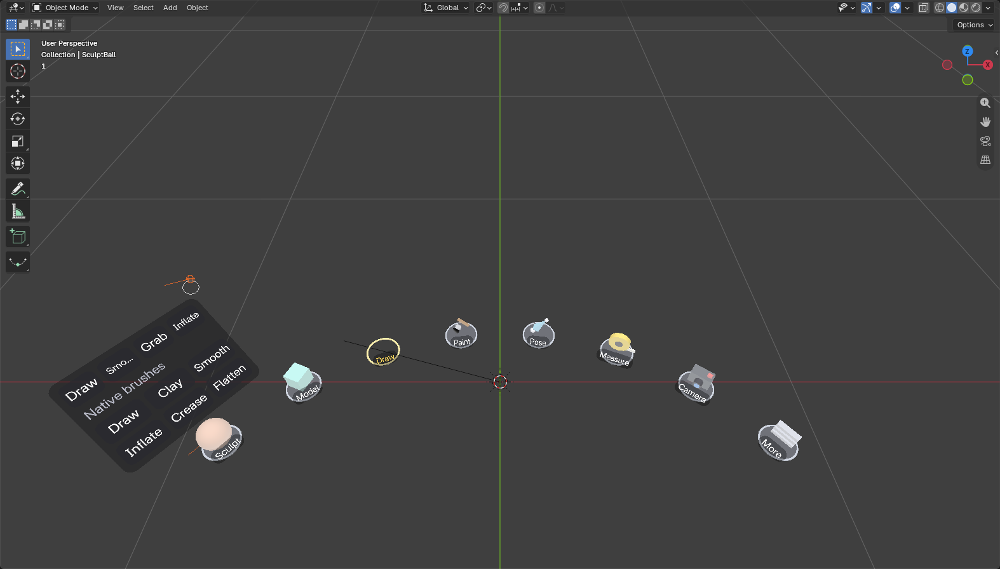
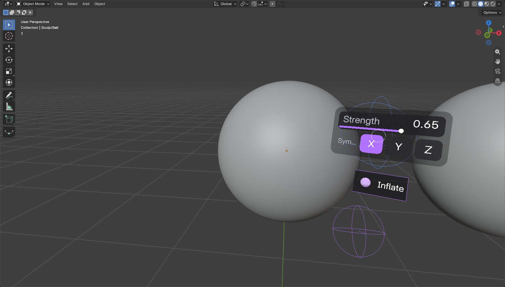
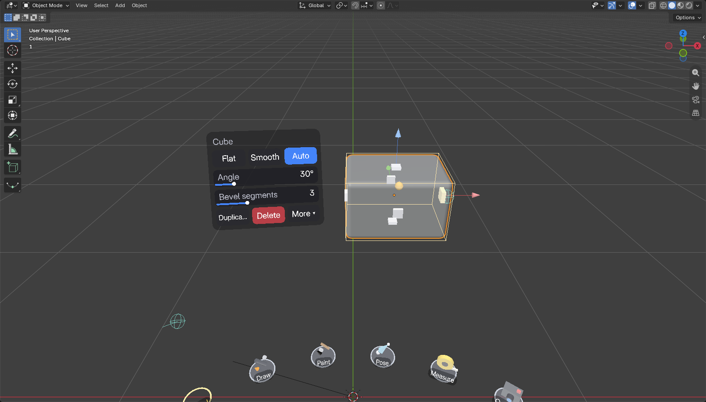
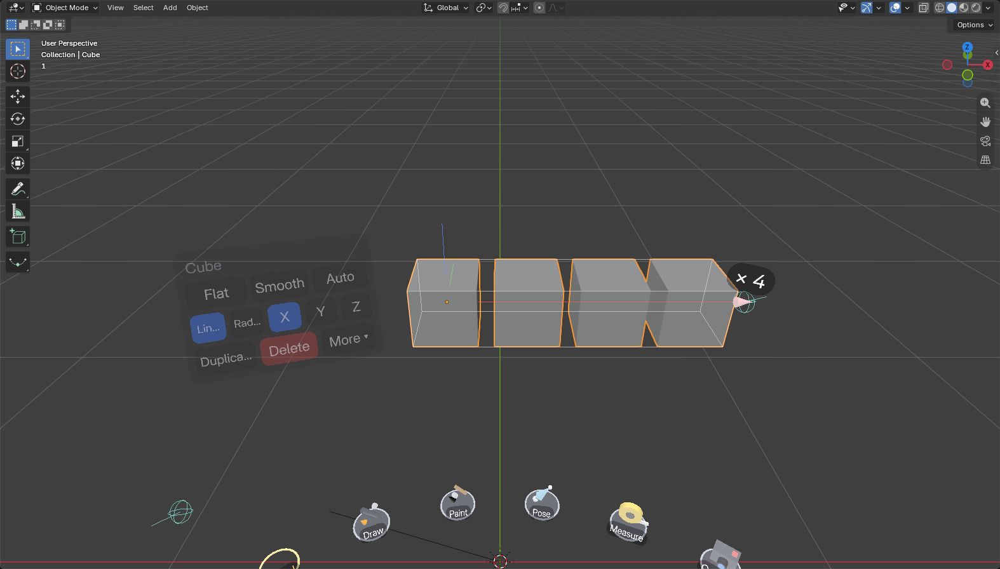
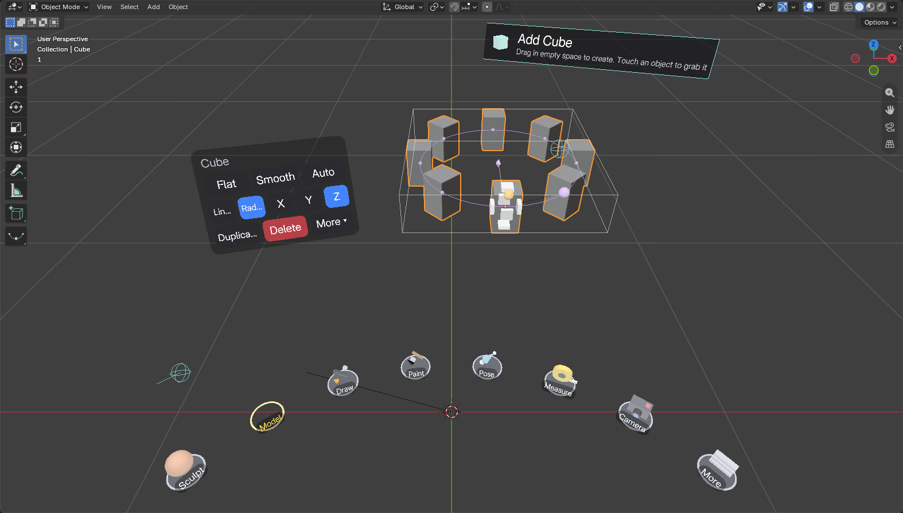
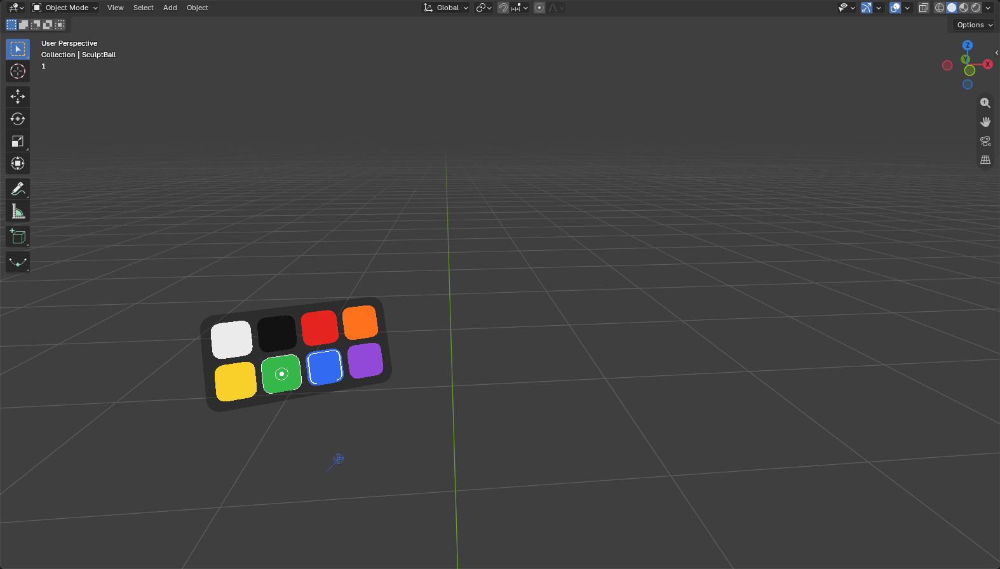
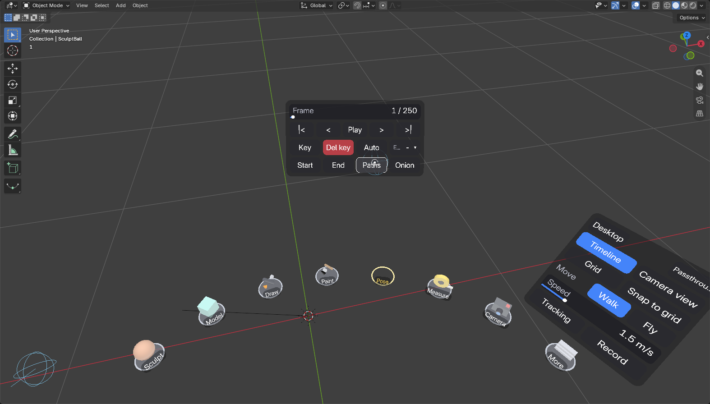
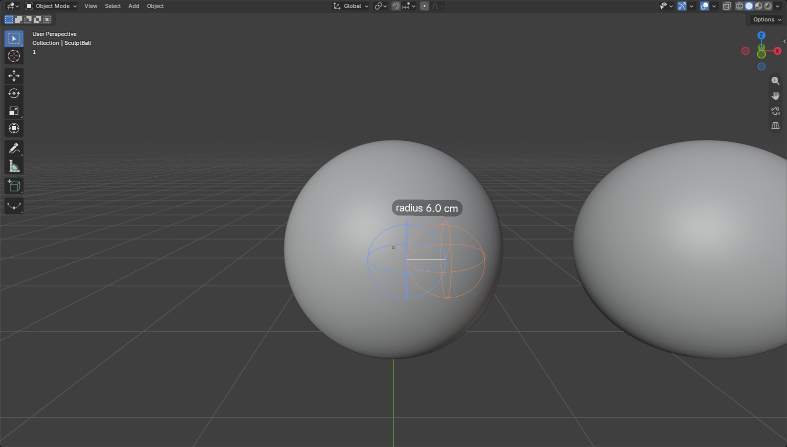

# UI rework B: spatial, direct manipulation

The hand panel is gone. The UI lives in the world, where the work is: you change things by
reaching for them and pulling, not by reading menus.

## The bet

**Hypothesis:** in VR, a tool you can *see and take* and a setting you can *grab on the thing it
changes* are faster to find, easier to remember and more pleasant than the same controls in a
pointed-at menu. If that holds, the panel's tabs, pages and sliders can mostly disappear, and the
few settings left over fit in a small drawer.

Principles:

1. **Tools are things.** Each tool is a small 3D token on a belt at your waist. What's in your hand
   is obvious: its socket on the belt is empty and lit, its name (with the same token as the icon)
   rides above your right hand.
2. **Settings live on what they change.** Size is a handle on the face, the bevel is a bead on the
   edge, an array is an arrow you pull copies out of, the mirror center is a diamond you move,
   the brush size is the ring at your tip.
3. **Touch, don't point.** There is no ray (except at the desktop screen, which is a screen). A
   trigger press acts on whatever the tip is *in*: a chip, a token, a handle, a ring.
4. **Show only what's relevant, when it's relevant.** Gizmos and chips appear as a tip comes near
   the object, the tool's options as your other hand comes near it, a token's variants as you
   reach for it. Everything else fades out.
5. **Feel it.** A light buzz when a tip enters a chip, token, handle or ring; a tick per copy, per
   5 mm of brush size.
6. **A drawer for the rest.** Desktop window, passthrough, navigation, grid, tracking, timeline:
   one card behind the dock's last slot, closed unless you open it.

## What's where

| Thing | Where it is | Pressed by |
|---|---|---|
| **Dock** (`dock.py`) | A belt of 8 slots 52 cm below the headset, 40 cm out, spanning 104 degrees in front of you. Sculpt, Model, Draw, Paint, Pose, Measure, Camera, More (drawer). It follows you lazily: it stays put while a tip is in it, and glides after you once you walk 40 cm or turn 55 degrees. | Either tip |
| **Tray** | Above the token a tip last touched: its variants (brushes, shapes, styles, markers). | Either tip |
| **Tool tag** | Above the right controller: the tool's name and token. As the left tip comes within ~20 cm, its option chips rise above it. | Left tip only |
| **Palette** | Above the left controller in Draw and Paint mode: colors (and in Paint, hue / saturation / value with color ramps, Swap, Set up). Faint until the right tip comes near. | Right tip only |
| **Object chips** | Beside the selected object (Model mode), on your left, pulled in to arm's reach if the object is far. Shown while a tip is within ~25 cm of the object or the chips. | Either tip |
| **Gizmos** (`gizmos.py`) | On the selected object, shown while a tip is within 20 cm of it (or of its copies). | Either tip |
| **Drawer** | Above the dock's last slot, while open. | Either tip |
| **Timeline strip** | Above the middle of the dock: a faint scrubber; the whole strip when a tip comes near. | Either tip |
| **Pickers** | Float where the select chip was pressed (All shapes, cameras, rigs, enum settings, thickness, interpolation). Modal: other cards hide until you choose or Close. | Either tip |

## Interaction map

Every feature in the README's Features and Controls, and how you reach it now.

### Taking tools

| Feature | How |
|---|---|
| Switch mode (Sculpt, Model, Draw, Paint, Pose, Tools) | Reach into its token on the dock, pull the trigger. Y still steps to the next tool. |
| Tape measure / scene camera | Their own tokens (Measure, Camera). |
| Put the tool back | Touch its empty (lit) socket: an **empty hand**, whose trigger grabs and moves objects and does nothing in empty space. |
| Brushes, shapes, styles, markers | Reach for a token: its tray fans out above it; touch a variant. Taking a variant also takes the tool. |
| Show / hide the whole UI | Left stick click (dock, tags, chips, gizmos; a clean view). |

### Sculpt

| Feature | How |
|---|---|
| Python brushes (Draw, Smooth, Grab, Inflate) | Sculpt tray, first row. |
| Native brushes (Draw, Clay, Smooth, Inflate, Crease, Flatten) | Sculpt tray, "Native brushes" rows. Picking one switches the engine; picking a Python brush switches back. |
| Radius | Pull the ring: with the other hand's tip on the rim of the ring, pull the trigger and spread or close your hands. Right stick click still steps 1, 2, 4, 8, 16 cm. |
| Strength | Tag slider. |
| Symmetry X / Y / Z | Tag chips. |
| Next brush | B. |
| Left hand inverts, Grab rotates, tip offset | Desktop sidebar (unchanged). |

### Model

| Feature | How |
|---|---|
| Create a primitive | Drag in empty space (unchanged). |
| Choose the primitive | Model tray: Cube, Cylinder, Sphere, Cone, Torus, Plane, Ico, Monkey; **All shapes** opens a picker with every Add > Mesh entry, extensions included (categories, pages). B steps through the list. |
| Grab, move, rotate | Trigger inside the object (unchanged). |
| New as Object / Cut / Union / Intersect | Tag chips. |
| Snap: grid, surface, 15 degrees | Tag chips (Grid, Surface, 15°). Grid size: drawer. |
| Resize | **Face handles**: one in the middle of each face. Pull one out or push it in; the opposite face stays put. Cube: its size per axis; Cylinder: radius (sides) and height (top / bottom); other primitives and plain meshes: scaled along that axis. Snaps to the grid with Snap on. Shows the size while dragging. |
| Subdivisions, segments, an operator's settings (gear teeth, ...) | Object chips > More (paged, enum pickers, toggles). |
| Shading Flat / Smooth / Auto, Auto angle | Object chips. |
| Hard / soft edges, clear marks | Model tray: **Hard edges**, **Soft edges**, **Clear marks** markers. Touch edges; the left hand clears. Taking a shape puts the marker down. Marks show on the edges while you work on the object. |
| Bevel width | **Bevel bead** on the top edge nearest you: pull it in along the corner (the bead sits where the bevel ends; an arc shows its profile). Pull it back out past the edge: no bevel. |
| Bevel segments, Bevel on / off | Object chips (Segments while there's a bevel; More > Bevel). |
| Linear array: count | **Arrow** out of each side (X red, Y green, Z blue): drag it out and a copy appears each time it passes one more step (you feel each one). Push it back to remove copies. Another side's arrow moves the array to that axis. |
| Linear array: gap | **Gap bead** on the first copy: the copy follows your hand. |
| Radial array | Object chips: Radial (and the axis X / Y / Z). Then a **ring** with a bead per copy: drag the count bead around it (closer to the original = more copies), and move the **center cross**. |
| Linear / Radial, axis | Object chips (while there's an array). |
| Mirror X / Y / Z | Object chips > More. |
| Mirror center | The **diamond** at the "VR Mirror Center": grab and move it. |
| Solidify, thickness | Object chips > More > Solidify; Thickness chip while it's on. |
| Cutter: Cut / Union / Intersect, Apply, Remove, Select object | The cutter's own chips. |
| Show cutters, Apply all, solver Fast / Exact | The target's chips > More (when it has cutters). |
| Duplicate, Delete | Object chips. |

### Draw

| Feature | How |
|---|---|
| Tube, Ribbon, Note, Edit, Erase | Draw tray. |
| Color | Palette on the left hand: dip the right tip into a swatch. The pen token's tip shows the color. |
| Width | Pull the ring at the pen tip (the ring is the stroke width). |
| Smoothing, Thickness mode (picker), Taper length | Tag. |
| Mirror X / Y / Z | Tag chips. |
| Mirror center (3D cursor) | A diamond at the cursor while mirroring: grab and move it. |
| Undo the last stroke | B, or the tag's Undo stroke. |

### Paint

| Feature | How |
|---|---|
| Hard, Soft, Airbrush, Blur, Smear, Erase; Pick color | Paint tray. |
| Contact / Spray, Strength, Undo stroke | Tag. B undoes too. |
| Swatches, hue / saturation / value, Swap, the second color | Palette. |
| Set up for painting, texture size | Palette (shown instead of the colors while the mesh isn't ready). |
| Radius | Pull the ring; right stick click. |

### Pose and puppeteering

| Feature | How |
|---|---|
| FK / IK | Pose tray; B. |
| Rig (or Objects) | Tag: Rig picker. |
| Mirror X, Bones, IK chain, Reset bone, Reset pose | Tag (IK chain also on the right stick click). |
| Bind L / R / head, Unbind, Rec / Stop | Tag. |
| Grab bones / objects | Trigger on them (unchanged). |

### Tools

| Feature | How |
|---|---|
| Measure: drag, Show, Undo, Clear | Trigger drags; tag chips; B removes the last. |
| Camera: aim, choose, New here, Lens, Pin preview | Trigger aims; tag (camera picker, New here, Lens, Pin preview); B next camera. The viewfinder sits beside the tag. |
| Pinned camera preview | Drawer > Camera view (or the camera's tag): beside the timeline strip (above the left hand without it). |

### Drawer and timeline

| Feature | How |
|---|---|
| Desktop window, Bring here | Drawer. Using it from VR is unchanged (ray, trigger = left button, ...). |
| Passthrough | Drawer. |
| Timeline on / off | Drawer. |
| 3D grid, Snap to grid, grid size | Drawer. |
| Walk / Fly, speed | Drawer. |
| Tracking objects, Record | Drawer. |
| Frame scrubber with key ticks, play, frame / key steps, Key, Del key, Auto, Ease, Start, End, Paths, Onion | Timeline strip above the dock. |
| Motion path keys | Grab a marker (unchanged). |

### Controller buttons

Unchanged on purpose, so the comparison is about the UI and not about new bindings: trigger = use
what the tip is in (then the scene), B = next brush / undo, Y = next tool, right stick click =
next radius, left stick click = show / hide the UI, sticks = walk / fly.

## What I expect it to do better than a panel

- **Finding tools by shape and place.** After a few minutes your hand should go to the Model
  token without looking, like reaching for a tool on a bench.
- **Editing by feel.** Resizing a box by its face, beveling by its edge, pulling copies out of an
  object: you see the result where you look, and the number shows where your hand is. No mapping
  from a slider in your left hand to an object a meter away.
- **A clean view.** Nothing floats in front of your work unless a hand is near it. The left
  controller is free (no panel to hold up).
- **Two hands.** The other hand adjusts the tool you hold (the tag), or pulls its ring, like
  adjusting a real tool.
- **Fewer pages.** Cuts / Finish / Array / Shape pages are gone: what's relevant to the selection
  shows; the rest is under More.

## What I expect it to do worse

- **Discoverability of the long tail.** "Where is Solidify?" has no obvious answer until you open
  More once. A panel shows everything.
- **Reach and posture.** The dock is at your waist: looking down to it is a head movement, and
  seated users may find it low. Gizmos on far objects need you to walk up to them (chips come in
  to arm's reach; handles don't).
- **Precision.** Handles are as precise as your hand; there's no typed value. Grid snap helps
  for sizes, and the readout shows the value, but a slider was easier to hit an exact number on.
- **Accidental grabs.** A tip working near a handle, a token or the other hand's ring can take it
  instead of the scene (handles hide while you make cutters or mark edges, tokens need the tip
  inside them, rings need the rim, not the middle).
- **Two-handed tags.** The tool's options need the other hand; one-handed use goes through the
  dock and the gizmos only.
- **Depth.** Touching a card in mid-air needs depth judgment (there's a touch ring that shrinks
  as you approach, and a 3 cm depth to press in); a ray is more forgiving at a distance.

## Try this in the headset

1. Without instructions: take the pen, draw a stroke, then take the clay ball and sculpt. Did you
   find the tokens by looking, or by memory after a few tries? Is the belt at a good height?
2. Put the tool back (touch its empty socket) and move an object with the empty hand.
3. Model: make a box, resize it from one face, then from the opposite one. Does the opposite face
   staying put feel right?
4. Pull the bevel bead in and back out. Can you find it on every box?
5. Pull an X arrow out to 4 copies, then move the gap bead. Switch to Radial on the chips and
   drag the ring's bead around. Is "drag the next copy to where you want it" intuitive?
6. Cut a hole: Cut on the tag, drag on the box. Flip the cutter to Union on its chips.
7. Grow the brush by putting the left tip on the right ring's rim and spreading your hands.
   Do the 5 mm ticks help?
8. Draw mode: pick colors from the palette on your left hand. Paint mode: hue, saturation, value.
9. Change the strength on the tag with the left hand while holding the right still.
10. Open the drawer: switch to Fly, show the timeline, scrub it. Was the drawer easy to find when
    you needed it?
11. Turn around and walk a few meters: does the belt follow without getting in the way, and stay
    put while you reach into it?
12. Overall: compared with the panel, did you look *at the UI* less and *at your work* more?

## Implementation notes

- A trigger press goes to `spatial.pick()` first (chip, token, ring, handle), then to the old
  routing (desktop screen, path keys, mark, grab / create, draw, paint, pose, tools).
- Chip cards (`chips.py`) are laid out with `vr_ui.layout` (rows built in `menus.py`) and hit by
  the tip's position in the card's plane: within the chip (+5 mm) and within 3 cm of the plane.
  Cards on a hand (`owner`) can't be pressed by that hand. Sliders follow the tip projected on the
  card's plane while the trigger is held.
- Tokens and handles (`shapes.py`) are small meshes built once into GPU batches and drawn with one
  lit shader (wrap-around diffuse, a rim, and a glow for hover); flat colors if the shader can't
  be made.
- `spatial.cards()` rebuilds the cards per press (fresh state) and caches them for 6 ms for
  drawing and the hover tick (both eyes of a frame share them). The hover haptics run in
  `live.py`'s 90 Hz timer while the UI is shown.
- Tuning knobs: `dock.DROP`, `RADIUS`, `ARC`, `TOKEN_SIZE`, `REACH`, `FOLLOW_*`; `chips.TOUCH_DEPTH`;
  `spatial.HAND_WAKE`, `CARD_WAKE`, `REACH_MAX`, `RING_RIM`; `gizmos.REACH`, `NEAR`, `ARROW_OUT`.
- Tests: `tests/test_spatial.py` (dock placement and following, taking and putting back tools,
  trays, the tag, the palette, object chips, every gizmo drag, ring pulls, pickers, haptics,
  hiding). Preview: `tests/spatial_preview.py` renders the screenshots above from a headset-like
  view (about 90 degrees across).
